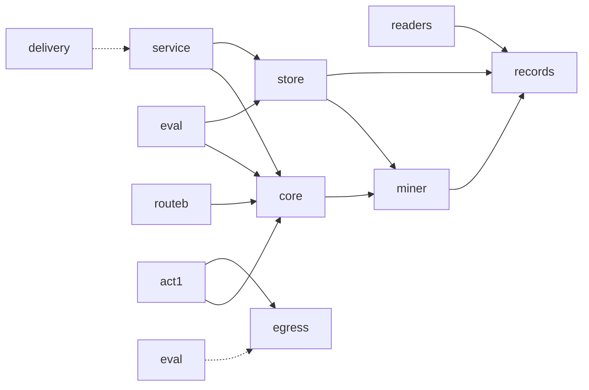

# ai-symbiont: engineering rules for agents and contributors

Read this file first, then the `AGENTS.md` in any directory you touch. Each `AGENTS.md` opens with "See root CLAUDE.md" and adds only that layer's purpose, invariants and review focus.

## What this repo is

ai-symbiont mines a developer's agent history for pain points (a file reworked three times, a command that failed the same way twice, a user correction) and pushes warnings and recalls back into the coding harness as plain domain prose. A pure core decides when to speak; readers, a local store, a localhost service and thin delivery clients (MCP server, hooks, a mini-SWE-agent wrapper) sit around it. An offline replay and pre-registered runs decide which learner is live; a fly-mushroom-body learner stands next to plain counters and is judged against them. Act 1 shows a model playing Freedoom via ViZDoom from a text description. Route B trains a personal LoRA on the same history.

## Commands

```bash
uv sync --group dev                      # dev tools are pinned in pyproject.toml; run it in EVERY new worktree
uv run pytest -q                         # whole suite, about half a minute; unmarked tests run in airplane mode
scripts/gates/run.sh fast                # quality gates on changed files vs main
scripts/gates/run.sh full                # fast + history scan, import-linter, mypy, coverage, lockfile
ops/secrets_scan.sh                      # whole-tree and whole-history secrets scan: before EVERY push
scripts/publish/check_export.sh          # git archive HEAD, every sensitive-data check on the exported files: before the FIRST public push
uv run python scripts/gates/measure_baseline.py --write   # how far the unchanged tree is from the gates (phase 2 input)
```

`scripts/install-hooks.sh` arms the git hooks and is run by the owner, not by agents mid-task.

## Binding rules

1. **Pure core.** `src/symbiont/records`, `miner` and `core` use no network, clock, harness, Docker, log files or environment variables. `tests/conftest.py` blocks sockets for every unmarked test; `tests/test_boundaries.py` and `.importlinter` enforce the import rules. Periphery tests carry `@pytest.mark.periphery`.
2. **Notes to models are domain prose.** Never scores, feature names, thresholds or cell activations. `recall` takes one plain question string: no modes, thresholds or k.
3. **Spark privacy.** Records with `spark_safe=False` (SWE-chat, the owner's private sessions) never reach a Spark-bound prompt. Spark-bound code receives `Store.spark_view()`, which raises `SparkPrivacyViolationError` and never filters quietly. **One door out:** every outbound HTTP call in `src/` goes through `symbiont.egress.post_json`, which refuses Spark, Contributor and Wonder payloads with undeclared or `spark_safe=False` provenance, a non-https URL or a host other than `api.meta.ai` (`REMOTE_HOSTS`), and logs sizes and provenance, never text. Under `src/` only `symbiont.egress` may import anything outside an explicit allowed set (stdlib minus its network modules, `symbiont`, `numpy`, `vizdoom`; semgrep `sym-single-egress`, `sym-dynamic-import`, `sym-network-subprocess`, plus the import-linter contract `network-only-through-egress`), and no log or print carries prompt text (`sym-no-prompt-logging`, a name heuristic: log `len(prompt)`, not `prompt.text`). Act 1's Glimmer client uses `Endpoint.LOCAL_GLIMMER` (loopback or LAN hosts only).
4. **Hold-out.** No trajectory of a scored task enters a store that a scored arm reads. `add_records` takes the held-out ids and raises `HoldOutViolationError`.
5. **Data is never committed.** Raw dataset rows, transcripts and `data/` stay local (gitignored). Publish counts and labels only. Test fixtures are synthetic and hand-written.
6. **Science tags.** Every claim is tagged `[measured]`, `[established]` or `[hypothesis]`. Every result row is labeled floor, ceiling, reference or under test. The counters row is always printed beside the fly row. No speed-of-learning claims; say "a learner built on the fly's real circuit".
7. **Prereg before scored runs.** A scored run needs a frozen, committed file in `prereg/`. Amendments are new dated files, never edits. A scored runner takes `--scored --prereg <file>` (`symbiont.eval.prereg_git.require_frozen`) and refuses without a prereg that is tracked and unchanged against HEAD, and, for an amendment (`Amends: prereg/<original>.md`), whose original is not frozen too; the file's sha256 and adding commit go into the results JSON, and a run without `--scored` is labeled exploratory.
8. **Naming.** Say "plays Freedoom via ViZDoom"; never brand the project as Doom. ViZDoom is a dependency, never vendored. FlyWire wiring is an optional user download, never committed.
9. **Git.** No stash, amend, reset, rebase or force-push; use a temporary WIP commit instead. Commit with explicit paths, never `git add -A` or `git add .`. Never push from an agent worktree. Create the GitHub repo and make the first push only on the owner's go.
10. **Publish.** Run `ops/secrets_scan.sh` before every push and `scripts/publish/check_export.sh` before the first public one. Never push `data/`, transcripts, private content or secrets. Private addresses, hostnames, user names, MAC addresses, e-mail addresses and phone numbers do not belong in tracked files (gitleaks rules and the owner-terms check enforce it). `results/` holds `.json` files of counts, ids and labels only (value shapes are allowlisted; sentences only under the label fields). Weights, `*.wad` and files over 1 MB are never committed.
11. **Diagrams** are mermaid only, never ASCII art.
12. **American spelling** everywhere: names, comments, docs (`license`, `color`, `behavior`, `labeled`, `normalize`). Gate QG-RD-05 (codespell `en-GB_to_en-US`) fails a changed file that strays.

## The negentropic principles

Software decays. Six Principles push back against ten named decays (Violations). Name the failure when you see it, and use the right name: calling a Distributed Monolith a Black Box is a misdiagnosis however good the prose.

| Principle | Preserves | Violated by |
|---|---|---|
| **Anchor** | Intent: the code carries its *why* | Forensic Coding, Fossil Comments |
| **Shield** | Structure: units are independently replaceable | Distributed Monolith, God Class / God Method |
| **Filter** | Narrative: call sites read as domain prose | Leaky Narrative |
| **Buffer** | Subsidiarity: the core never depends on infrastructure (the Airplane Test) | Infected Core |
| **Sensor** | Decipherability: boundaries, side effects and state are observable | Black Box, Silent Fallback |
| **Engine** | Mechanical sympathy: respect the machine, algorithms before hardware | Computational Friction, Paper Tiger |

| Violation | Tell | Where it bites here |
|---|---|---|
| **Paper Tiger** | Meets the spec, fails the need; green CI on a feature nobody can use | A fly learner that ties plain counters. The counters row prints beside the fly row; the dashboard exporter refuses a fly lane without one. |
| **Distributed Monolith** | A small change needs edits in N services; shared mutable state across instances | The record schema and the local store are the only contracts. Hooks and MCP are thin clients of one service. A new harness is one new reader file. |
| **Leaky Narrative** | Callers pass flags, modes, SQL fragments or options dicts they had to read source to fill | `recall(question)` has one string. Notes read as sentences, not scores. |
| **Infected Core** | Unit tests need a database, a clock or a network | Pure core with state passed in; the store and service wrap it. Core passes the Airplane Test. |
| **Black Box** | "It just stopped working" with no signal; no per-stage timing | Every service call writes an event to the event log; the dashboard replays it. First move on a mystery is to restore the sensor, not to guess. |
| **Computational Friction** | Scale by hardware, never by thinking; N+1 behind a cache | Cached features and resumable state in the offline replay; profile a slow loop before re-running it. |
| **Forensic Coding** | `git blame` is the only documentation; `MAGIC = 47` | Constants carry the reason (prereg section, source). Public functions state why and what they raise. |
| **God Class / God Method** | A function with 2+ booleans and a multi-branch switch; a `Manager` with 30 methods | One file per harness reader, one file per signal. Two booleans on one function is forbidden. |
| **Fossil Comments** | A comment contradicts the code below it; a dated TODO nobody owns | Delete on sight. Commented-out code does not stay. |
| **Silent Fallback** | `try/except: pass`; retry that returns `None`; a default that masks missing data | The WAD parser raises `WadError`; a reader raises `ReadError` naming file and line; an unrecognized task id raises rather than matching nothing; a down service prints "symbiont offline", never an empty note. |

### The reasoning loop

Every technical answer, design, diagnosis or piece of code runs this loop:

1. **Name the smell.** Which Violation does this match? If you cannot pin one, say so and probe.
2. **Name the Principle at stake.** The Violation negates a Principle; the Principle says what "fixed" looks like.
3. **Derive the recommendation from the name.** If deleting the name would not change the advice, the name was decoration.
4. **Engage hypotheticals on their terms.** "Should I add a fourth boolean?" is answerable without code: it is a God Method in larval form and a Leaky Narrative at every call site.
5. **Name before you type.** Before writing a unit, state which Violation its shape exists to prevent, in the plan or PR description, not in the code. That name constrains the API, the error handling and the tests.

### The Load-Bearing Test

Redact every Principle and Violation name from your draft. If the advice is identical, the names were decoration: rewrite until the recommendation cannot be stated without them (the name chose the *order* of investigation, the *shape* of the API, or what was ruled out). Example: "this is a Black Box, so the first move is per-stage timing, not a bigger machine" passes; "this is a Black Box and we should improve observability" does not.

### Mechanical rules

- One function, one level of abstraction. Do not mix orchestration with arithmetic.
- A function fits in the reader's head; otherwise extract a named helper.
- Nesting stays shallow: invert conditions, return early, extract.
- Comments explain why, never what.
- No new public surface without a test; the test is the first caller and the first defense against Paper Tiger.
- Names are capabilities in the domain's language: not `handle`, `process`, `manage`, `do`, `Manager`, `Helper`.
- Booleans at arity 2 or more are forbidden: use named variants or a `StrEnum`. An options dict respells the leak.
- No silent catches. If you must swallow, log loudly with context and say why.
- Comments and docstrings are terse: one line by default; a why only when the code can't show it; never name a Principle or Violation in code (that reasoning goes in the plan or PR). Gate QG-RD-04.

**Naming (gate QG-RD-02/03, `scripts/gates/check_naming.py`).** These fail the gate; the message names the Violation.

- No vague words as whole snake_case or CamelCase parts of a function, class or module name: `handle`, `process`, `manage`, `do`, `run_it`, `helper`, `util(s)`, `misc`, `data`, `info`, `stuff`, `Manager`, `Handler`, `Processor`. They hide a responsibility (Forensic Coding) and make call sites say nothing (Leaky Narrative). `dataset_rows` and `metadata_for` are fine; `load_data` is not.
- No single-letter names except loop and comprehension targets, `x`, `y` and `_`.
- A function with two or more bool parameters fails (God Method, Leaky Narrative). A flag-like `is_`, `use_` or `enable_` parameter that can be passed positionally warns: make it keyword-only.
- Waivers live in the delete-only `.naming-waivers.txt`, each with owner, reason and an expiry date; an entry without a future expiry fails the gate.

**Size limits (God Method, God Class; `lizard` plus AST checks, thresholds are printed in the gate output).**

| Unit | Pure core (`records`, `miner`, `core`, `routeb`) | Rest of `src/` | Tests |
|---|---|---|---|
| Function or method | 30 lines of code, CCN 10 | 40 lines of code, CCN 12 (also `scripts/`, `ops/`) | 60 lines of code |
| Parameters | 5 | 5 | 12 |
| Nesting depth | 3 | 3 | not checked |
| Class | 200 lines and 12 public methods | same | same |
| File | 400 lines (warning above 300) | 400 lines (warning above 300; also `scripts/`, `ops/`) | 600 lines |

There is no carve-out for tooling: the gate scripts obey the caps they enforce. Phase 1 enforces these on changed files only; `scripts/gates/baseline.json` holds the whole-tree counts for the phase 2 cleanup.

### Workflow rules

1. **Plan before code.** The plan cites at least one Principle it serves and any Violation it avoids.
2. **Flag existing violations before extending them.** Do not inherit rot silently.
3. **Refactor before extend.** Fix a wrong shape first; never stack features on a broken abstraction.
4. **Engage, do not defer.** Refusing to reason without code is itself a Paper Tiger answer.
5. **The principles apply to how you work.** A slow or repeated command in your own loop is Computational Friction: scope it down, cache it or parallelize it before running it again.

### Self-audit before closing a technical turn

(1) Named at least two failure modes doing distinct work. (2) Ran the Load-Bearing Test. (3) Used the right name. (4) For code, the API matches the Violation it prevents: a retry that returns `None` fails its Silent Fallback audit, a function with two boolean flags fails its God Method audit, a process-local rate limiter fails its Distributed Monolith audit, a "fail open" branch fails its Silent Fallback audit. Flag any failed check plainly.

## Quality gates

`docs/standards/quality-gates.html` is the standard: every gate names the one Violation it makes impossible. One script, `scripts/gates/run.sh [fast|full]`, is the single definition of green; hooks and CI call it. Pre-commit runs the changed-file checks plus the unit tests of the packages a commit touches (about 4 s, 11 s worst case measured); pre-push runs `full`: the whole suite with its count floor, the `run.sh` tests, the history scan, gate integrity per commit and a list of every `GATE-CHANGE` commit.

| Gate family | Tool | Prevents |
|---|---|---|
| Secrets and private infrastructure | gitleaks with `.gitleaks.toml` (Meta keys, HF tokens, private IPs and hostnames, home paths, MAC, e-mail, phone; built-ins for GitHub, cloud and private keys) | Silent Fallback, Black Box |
| Owner identifiers | `scripts/gates/check_private_terms.py` (terms file `~/.config/symbiont/private-terms.txt`, outside the repo) | Silent Fallback at the publish boundary |
| Data, transcript, weights and large-file path guard | `scripts/gates/check_paths.sh` | Leaky Narrative at the repo boundary |
| Result-file content | `scripts/gates/check_results_content.py` (counts, ids, labels only) | Leaky Narrative at the repo boundary |
| Edit-time secrets guard | `.claude/hooks/guard_paths.sh` (gitleaks on the text being written) | Silent Fallback, earliest stage |
| Egress | semgrep `sym-single-egress`, `sym-no-prompt-logging`; `src/symbiont/egress/` | Distributed Monolith, Silent Fallback, Black Box |
| Publish check | `scripts/publish/check_export.sh` (exported tree, no history, no baseline) | Silent Fallback at the publish boundary |
| Lint and format | ruff (`pyproject.toml`) | Forensic Coding, Fossil Comments |
| American spelling | codespell `--builtin en-GB_to_en-US` (QG-RD-05) | Leaky Narrative, Forensic Coding |
| Complexity, nesting, file length | lizard plus AST checks; delete-only `.lizard-whitelist.txt` | God Method, God Class |
| Custom rules | semgrep pinned in `.semgrep/VERSION`, rules in `.semgrep/symbiont/` | one rule per Violation |
| Architecture | import-linter (`.importlinter`) plus `tests/test_boundaries.py` | Infected Core, Distributed Monolith |
| Tests | pytest, zero skips, count floor in `scripts/gates/test-floor.txt` | Paper Tiger |
| Claims and results | `check_claims.py`, `check_results.py` | Paper Tiger, Silent Fallback |

**Secrets history.** `scripts/gates/check_secrets.sh history` scans the whole git history against `.gitleaks-baseline.json`, which lists exactly the findings already published in committed history (private LAN addresses and home paths in early docs and calibration scripts; history is never rewritten, and the owner publishes from a fresh repo). Old findings are reported by that file, never hidden; any new finding fails. `ops/secrets_scan.sh` runs the same history scan plus a working-tree scan of every tracked file, so it stays red until those files are cleaned.

**Publish check.** `scripts/publish/check_export.sh` exports every file of HEAD (`checkout-index`, so `export-ignore` cannot hide one) to a temp dir and runs the path, gitleaks, owner-terms, result-content and egress checks on the exported files using the exported commit's own scripts and config (it refuses to run while a gate file differs from HEAD), so a finding hidden by the history baseline or the diff-only scan still turns it red. It needs `~/.config/symbiont/private-terms.txt` (one owner identifier per line) and fails closed without it. Commit first: uncommitted files are not exported.

**The gates guard themselves.** `scripts/gates/check_gate_integrity.py` (QG-GATE-01) compares the gate configuration with the merge-base and fails on an added waiver, a lowered test floor, or any change to gate scripts, hooks, gitleaks or semgrep config, `.importlinter`, or the ruff/mypy/coverage/pytest tables, unless THAT commit's own message carries `GATE-CHANGE: <reason>` (an earlier commit's trailer unlocks nothing; the owner's ledger `scripts/gates/accepted-gate-changes.txt` can accept a named commit). Only the owner writes that trailer. The Claude hooks also deny edits to these paths, but a shell edit bypasses a hook; this check does not.

Phase 1 holds **changed files** to the full bar; existing offenders are counted in `scripts/gates/baseline.json` and cleaned in phase 2. Every gate fails closed: a missing tool or config is a failure, never a skipped check.

**Fix the gate's finding, never the gate.** Do not loosen a threshold, add a whitelist line, add `# noqa` or `# nosemgrep` without a reason, delete a failing test, or bypass a hook with `--no-verify`. Waiver files are delete-only and edited by the owner. A false positive is fixed in the rule, with a fixture that proves it, not suppressed at the call site.

## Layout

An arrow means "imports" (dotted: talks over localhost HTTP, no import). Nothing points into the pure core from the periphery side, and `delivery` reaches the core only through the service.



Directory rules: `src/symbiont/{records,miner,core,store,readers,eval,routeb,act1,delivery,service,egress}/AGENTS.md`, `tests/`, `ops/`, `dashboard/`, `scripts/`, `prereg/`, `docs/`. `spikes/` holds throwaway probes; nothing in `src/` imports from it.
