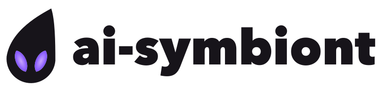

<h1>
  <picture>
    <source media="(prefers-color-scheme: dark)" srcset="docs/brand/logo-dark.svg">
    
  </picture>
</h1>

**Your coding agent keeps making the same mistake. This tells it before it happens again.**

- **Track:** Indie Developer · **Problem statement:** Push the Frontier.
- **Provenance:** built from scratch during the hackathon (Oct 26 – Nov 4, 2026); no prior code.
- **Meta models at runtime, with roles:**
  - **Muse Spark 1.3** (`api.meta.ai`): the coding agent, and it curates lessons. It also plays Freedoom via ViZDoom and drives a robot in Meta's Habitat simulator.
  - **Llama 3.2 1B Instruct** (open weights): the checker that must agree before any note is shown. It is LoRA-trained nightly on the user's machine; the adapters are on Hugging Face.
  - **Muse Code**: the harness (ai-symbiont is a plugin, through hooks and MCP).
  - **Muse Glimmer 30B** (open weights): the next step. In an early test with symbiont's lessons in its prompt, it solved 6 coding tasks against 2 without them (one run per task, exploratory; `results/lesson-pilot.json`) [measured]. Lessons trained into weights are remembered: one LoRA adapter on Llama 3.2 1B holding 100 lessons recalled 88% of them (65% on reworded questions), against 25% with all 100 in the prompt (`results/lesson-capacity.json`, exploratory) [measured]. Getting Glimmer to *use* trained-in lessons while it codes is the open part: our first coding LoRA scored 0.054 below plain Glimmer (stopped at 37 of 60 blocks; `results/core-v3-stopped-final.json`) [measured].
- **Bonus prize categories targeted:** Best Build on Meta Open Weight Models (Llama 3.2 1B checker), Best Agentic Use-Case, Best Creative Build.
- **Demo video:** (YouTube link coming). **Landing page:** <https://smalls257.github.io/ai-symbiont/>
- **Keyless demo (no API key, no network):** the interactive demo on the landing page, or `docker run --rm ai-symbiont demo` (build steps in Quickstart).

ai-symbiont reads your coding-agent history for pain points (a file reworked three times, a command
that failed the same way twice, a correction you had to make) and gives your agent a short warning
in plain prose before it repeats one. It runs on your computer.

## Results at a glance

ai-symbiont is a plugin for Muse Code, Meta's coding agent. It reads your past sessions on your own machine, finds the mistakes that came back, and shows the agent one short note in plain words at the moment it is about to repeat one. Every model run below used Muse Spark, Meta's model.

- **A rule only the maintainers' reviews state (coding, real public repo).** In sqlglot, a public SQL library, the rule "don't `.copy()` in generator code; the generator copies the whole tree up front" appears in no doc or code, only in maintainer reviews of earlier pull requests. symbiont learned it from those reviews and showed the agent the reviewer's own words. On the same real task (PR #7433), the agent added a forbidden `.copy()` in 7 of 10 runs without symbiont and 0 of 10 with it (p = 0.003); all 20 runs passed the task's tests. One repository, one rule, one task, one model; we wrote the tests because the PR had none. [measured] [pre-registered]
- **Corrected once, never repeated (coding).** The user states three rules for a repository once. Over 18 chances across 8 new tasks, the agent broke a rule 16 times without symbiont and 0 times with it; 8 of 8 tasks came out clean with it, 0 of 8 without. A synthetic, designed task, one model, one run per task, pre-registered. [measured] [pre-registered]
- **Habitat set the table.** A home robot in Meta's Habitat simulator set the table in 4 of 5 new episodes with symbiont's notes and 0 of 5 without. The notes came from the robot's own two failed attempts. Pasting every lesson into every prompt also solved 4 of 5, and with randomized hiding places it was 1 of 5 either way, so the lift is for one fixed home. One model, 5 seeds per arm; details in `docs/research/2026-11-03-habitat-results.md`. [measured] [pre-registered]
- **House rules.** The robot broke 30 house rules across 6 episodes without the owner's corrections and 0 across 6 with them. The corrections were scripted for the demo (`results/habitat-house-rules.json`). [measured] [pre-registered]
- **Freedoom.** Muse Spark plays Freedoom via ViZDoom and wrote its own rule from its failed games. Across 240 new games the rule raised the game score (0 to 1) by 0.16 against no rule. [measured] [pre-registered]
- **Precision.** 0 wrong notes in 501 shown, on 89 open-source projects it had never seen. A plain similarity search got 9 wrong. The test bugs were planted, not made by real developers. [measured] [pre-registered]
- **Nightly training.** Untrained, the checker blocked every note on code it had never seen. After one night of training on the project's own history it approved 61% of repeats, and 97.8% of what it approved was right: the same reach the ranker has alone, now with the checker's agreement. [measured] [pre-registered]

Live landing page, with recordings and every limit: <https://smalls257.github.io/ai-symbiont/>
Paper: <https://smalls257.github.io/ai-symbiont/paper.html>
Demo video: (link coming)

## Meta models used

- **Muse Spark** (`muse-spark-1.3-contributor`), through the Meta Model API at `https://api.meta.ai/v1` (docs: dev.meta.ai). It is the coding agent in every measured run, and it curates lessons.
- **Muse Glimmer 30B** (open weights). In the lesson-in-prompt pilot it solved 6 tasks with symbiont's lessons against 2 without (Tier 1 5 vs 2, Tier 2 1 vs 0, clean runs only; one lesson run per task, so counts, not rates; `results/lesson-pilot.json`) [measured]. It served as a local model in the calibration and lesson-in-prompt pilots, and as the base for Route B, a personal LoRA that trains lessons into the model's weights (builders and scripts in `src/symbiont/routeb` and `scripts/routeb`). Route B on coding is not better yet: solve rate 0.054 with the LoRA vs 0.108 for plain Glimmer, interval [-0.108, -0.014], stopped early at 37 of 60 blocks (`results/core-v3-stopped-final.json`) [measured]. Exploratory; a retrain with a shorter context is in development.
- **Llama 3.2 1B Instruct** (open weights), with a LoRA-trained judge, trained nightly per repository on your own machine. The adapters and the nightly kit are published on Hugging Face: <https://huggingface.co/smalls257/Llama-3.2-1B-symbiont-judge-adapters>
- **Muse Code**, the harness: ai-symbiont is a plugin (hooks and MCP) for it.

Pre-registered evaluations, with the result file, prereg and research note behind each number: [Benchmarks and evaluation](benchmarks/README.md).

## Quickstart

Install the command, then the plugin for your harness.

```bash
uv tool install git+https://github.com/smalls257/ai-symbiont
```

Claude Code:

```text
/plugin marketplace add https://github.com/smalls257/ai-symbiont
/plugin install symbiont@ai-symbiont
```

Muse Code:

```bash
muse plugins marketplace add ai-symbiont https://github.com/smalls257/ai-symbiont
muse plugins install symbiont@ai-symbiont
muse plugins approve symbiont
```

Start a session in a repository. The first time, symbiont says what it does and asks. Answer with
`/symbiont allow` (or `/symbiont decline`), then `/symbiont mine` to learn from this
repository's past Claude Code and Muse Code sessions (it finds both on its own, and opens the dashboard so you can watch the progress; `--no-open` skips that). `/symbiont` shows status, explains the last note, mutes it
or forgets its lessons. Its actions are MCP tools of the symbiont server (`symbiont_allow`,
`symbiont_mine`, `symbiont_status` and the rest), so they work where the harness shell is sandboxed
(Muse Code); the shell forms (`symbiont repo allow`, `symbiont repo mine`)
remain for a harness without MCP.

Try it without a key: `docker build -t ai-symbiont . && docker run --rm ai-symbiont demo`. It replays a synthetic billing-ledger session offline (onboarding note, `symbiont repo allow` and `repo mine`, house rules, a recall note, `symbiont why`) and needs no API key and no network. Locally: `scripts/demo/run.sh`. The interactive demo on the landing page needs nothing installed: <https://smalls257.github.io/ai-symbiont/>. Only runs that call Muse Spark need `META_API_KEY` (see `env.example`).

Optional: a container for running the test suite and the command-line tool (not the harness
plugins). `symbiont serve` binds 127.0.0.1 inside the container, so the service is not reachable
from the host; there is no `--host` option and this image does not change that.

```bash
docker build -t ai-symbiont .
docker run --rm ai-symbiont uv run pytest -q \
  --ignore=tests/dashboard/test_mining_view.py \
  --ignore=tests/gates/test_check_export.py \
  --ignore=tests/gates/test_claude_hooks.py \
  --ignore=tests/gates/test_frontend_gates.py \
  --ignore=tests/gates/test_gitleaks_rules.py \
  --ignore=tests/gates/test_run_script.py \
  --ignore=tests/gates/test_shell_gates.py \
  --ignore=tests/ops/test_gpu_run.py \
  --ignore=tests/scripts/test_sync_results_probe.py     # the tests that can run here
docker run --rm ai-symbiont symbiont --help      # the command line
```

The command above ignores nine test modules that need tools the image does not carry: gitleaks and the other quality-gate tools (`tests/gates/` modules for the secrets rules, the export check, the hooks, the shell gates and `run.sh`), Node (the JavaScript gate and the dashboard mining view), and the docker and ssh helpers for the GPU host (`tests/ops/test_gpu_run.py`, `tests/scripts/test_sync_results_probe.py`). In the container the rest gives 2703 passed and 0 failed [measured]. Without the `--ignore` flags the same image gives 2867 passed and 54 failed or errored [measured], all from those modules. Run the full suite on your machine with `uv sync --group dev && uv run pytest -q`.


## Learn from your team's PR reviews

symbiont asks once whether to learn from this repository's recent pull-request reviews and CI
failures; `/symbiont learn-from-prs` does it any time. Your session's model reads GitHub with your own
`gh` access and saves a few short lessons, each linked to its pull request on the dashboard.
symbiont itself makes no network call and stores only those lessons and links, locally. Details in
`docs/product/plugin.md`.

## Nightly training

`symbiont nightly` trains a small judge (Llama 3.2 1B with a LoRA adapter) on this repository's
lessons, on your own machine, so that recalls and notes get stricter about when a stored lesson
applies. It is the recipe of plug round 4's nightly arm: a fixed base (the general judge), all of
the repository's lessons so far, 15% habit replay [established], trained fresh each night and never
stacked on the last one. One difference, tagged `[hypothesis]`: the measured arm used Spark to invent
situations and labels, and this command makes no network call, so it rewords each lesson's
situation with a fixed list of templates instead. Its numbers are not that arm's numbers.

```bash
symbiont nightly                      # this repository, now
symbiont nightly --project NAME       # another stored project
symbiont nightly schedule install     # every day at 03:00 (--at HH:MM to change it)
symbiont nightly schedule status      # is it scheduled, and when
symbiont nightly schedule remove
```

It runs locally and uploads nothing. It trains with mlx-lm on Apple Silicon and with torch on an
NVIDIA GPU; on any other machine it says so and stops, and it never trains on the CPU. It prints
each stage's seconds and the lesson count, writes the nightly record only after the trainer exits
0, and a failed night leaves the older record, which then reads as stale. With no lessons it says
so and exits 2; any other failure exits 1. `symbiont status` and the dashboard header show one of
three states: never trained, trained on N lessons at a time, or stale (the lessons changed since).
The schedule uses launchd on macOS (a user LaunchAgent), a tagged line in your crontab on Linux
and Task Scheduler on Windows; a Mac that is asleep at the set time runs the job when it wakes.

**Install it with the nightly extra.** A plain `uv tool install` carries neither the trainer nor
torch, and `symbiont nightly` then says so and exits non-zero. One command installs everything the
nightly needs, with no repository checkout and no second Python:

```bash
uv tool install 'ai-symbiont[nightly] @ git+https://github.com/smalls257/ai-symbiont'
```

The `nightly` extra is mlx-lm on an Apple Silicon Mac (an environment marker), plus torch, peft and
transformers everywhere (the judge server and the kit merge run on torch; a Mac uses mps). The
trainer, the kit merge and the judge server all default to the Python that `symbiont` itself runs
on, so `--trainer-python` and `--judge-python` are only for a setup with separate environments. On
Linux and Windows the trainer needs a CUDA build of torch (PyPI's Windows wheel is CPU-only, so install
one from pytorch.org into the tool environment first). The scripts ship in the package and unpack to
`~/.symbiont/routea`; `SYMBIONT_ROUTEA_DIR` overrides them for development.

**One command.** `/symbiont onboard` allows the repository, mines it, saves your corrections and starts the first training; it needs nothing else: on the first run it downloads the model and kit itself (see Finding the downloads).

**From your coding agent.** `/symbiont nightly` (the `symbiont_nightly` tool, `symbiont nightly start`
in a shell) sets up if needed, trains in a detached process and returns within a minute; training
takes 1-4 minutes. `/symbiont status` then shows `training job: running`, `done on N lessons at T` or
`failed: <reason>`, and the checker starts or reloads when the job is done. With no kit and no folders
given it fails with the steps below; once a kit exists it needs no arguments.

**What it needs.** A judge kit folder (`--kit`, `$SYMBIONT_JUDGE_KIT`, else `~/.symbiont/judge-kit`)
holding `base/` (the general judge: Llama 3.2 1B with the round-4 general adapter merged in),
`general-rows.jsonl` and `habits.jsonl`; a Python with `mlx-lm` (`--trainer-python`, default: the install's own) or with CUDA
torch, transformers and peft; and the judge server, which ships inside the package
(`routea_bundle/`; a developer can point `SYMBIONT_ROUTEA_DIR` at a `scripts/routea` instead), run on
a Python with torch (`--judge-python`). After a night the command makes the judge server serve the new adapter: it hot-swaps a running server
or starts one (detached, log beside the adapter) and waits until it answers, and it records how to
start it again in the nightly record. Nothing else is needed: the symbiont service that the hooks
start on their own reads `<data-dir>/nightly` on every recall, so once a repository has a record, its
recalls are checked (the agree rule with that repository's judge) with no flags. If the checker is
down, for example after a reboot, the recall says `symbiont checker offline`, starts the server again
from the record and asks you to retry in a minute; it never falls back to the ranker alone. With no
record yet nothing changes (the ranker answers) and `symbiont status` and the dashboard say
`checker not trained yet; run symbiont nightly`. `symbiont why` names the checker that agreed to the
last note (its model, how many lessons it was trained on and when), never a score.

**What the checker gates.** Two kinds of note are recalls of a stored lesson, and with a trained
checker both go through the agree rule: the answer to a `recall` question, and the hook-time note
after a failed command ("Last time, `X` failed with E; it was fixed when you..."). For the hook
note the service describes the failure to the judge the way the lessons were described in training
(the command, the repository, the file, the last line of output), and if the judge disagrees there
is no note. The judge gets 0.35 s of the hook's 0.6 s budget [hypothesis]: if it is down you see `symbiont
checker offline` (and it is started again); if it is running but slower you see `symbiont checker
slow` and no note for that failure. Either way the failure is checked again next time it repeats. With the judge warm, a hook that reaches it takes about 0.14 s end to end on an Apple M-series Mac [measured]. The checker is strict by design: on 20 synthetic repeats it approved 1 [measured], and the rest got no note.
House rules, file rules and PR rulings are never gated: they are rules you or your team wrote, not
recalls. With no nightly record nothing is gated.

**Finding the downloads.** With no `base` or `kit` given, `symbiont nightly` uses a kit it already built, else looks for the Llama folder in `~/.symbiont/models/llama-3.2-1b-instruct`, then the Hugging Face cache (`$HF_HOME/hub` or `~/.cache/huggingface/hub`, newest snapshot); the kit in `~/.symbiont/models/nightly-kit`, then the cache's `nightly-kit/`. If nothing is found, the background job downloads them itself first (about 2.5 GB from Hugging Face, public files and no login: the base is the ungated `unsloth/Llama-3.2-1B-Instruct` copy of Meta's weights, and setup still checks its shape and chat template), into `~/.symbiont/models`; `/symbiont status` shows `downloading model 1.1 of 2.5 GB`. Doing it by hand also works: `hf auth login`, `hf download meta-llama/Llama-3.2-1B-Instruct`, `hf download ADAPTERS_REPO --include "nightly-kit/*"` (ADAPTERS_REPO as above).

**Building the kit (once).** Meta's license does not let us ship Llama weights, so you fetch the base
yourself and `symbiont nightly setup` merges the small public kit into it on your machine. It makes
no network call.

```bash
# accept Meta's license on https://huggingface.co/meta-llama/Llama-3.2-1B-Instruct, then:
huggingface-cli login
huggingface-cli download meta-llama/Llama-3.2-1B-Instruct --local-dir ./llama-3.2-1b-instruct   # about 2.5 GB
# the kit: the nightly-kit/ folder of https://huggingface.co/smalls257/Llama-3.2-1B-symbiont-judge-adapters
huggingface-cli download ADAPTERS_REPO --include 'nightly-kit/*' --local-dir ./kit   # about 100 MB; ADAPTERS_REPO is the path of that URL
symbiont nightly setup --base ./llama-3.2-1b-instruct --kit-files ./kit/nightly-kit   # or: /symbiont nightly, with base and kit set to those folders
```

Setup checks that the folder is Llama 3.2 1B Instruct (config, tokenizer, weights, chat template)
and that every kit file matches its pinned SHA-256, merges `judge-s0` and then `general` into the
base, and writes `base/`, `general-rows.jsonl` and `habits.jsonl` into the kit folder. A wrong or
missing file stops it with the exact download command. The kit's two row files are built from public
trajectories and templates, with no text from any hosted model; the Hugging Face folder's README
records how that was checked. Built with Llama; Llama 3.2 is under the Llama 3.2 Community License.

**How long.** Time grows with the number of lessons. Each distinct lesson becomes about 22 training rows with the replay mixed in [measured].
The trainer makes three passes over them.
On an Apple M-series Mac (48 GB) with 20 synthetic lessons (439 rows, 329 updates), two nights took 225 s and 221 s [measured].
Nearly all of that was training; reading lessons, building rows, converting and installing the adapter and writing the record took under a second together [measured].
Both nights ran while other jobs kept the machine's load average between 7 and 25, so an idle laptop should do better [hypothesis].
Run it overnight, not in a loop.

## Reproduce it

`REPRODUCE.md` has three tiers: a one-command demo (about a second, no model), a check that recomputes our headline numbers from committed files (about 10 seconds), and the rebuild of the code-fix study's data from a pinned public dataset.

## Privacy

Everything stays on this computer. The service listens on 127.0.0.1 only, the lessons live in
`~/.symbiont`, and nothing is stored for a repository until you say yes. Hook events are sent to
that local service and nowhere else. Notes quote a short excerpt of your own history back to your
own agent; they are never sent to a remote service by the plugin.

## Uninstall

Claude Code: `/plugin uninstall symbiont@ai-symbiont`. Muse Code: `muse plugins remove symbiont`.
Then `uv tool uninstall ai-symbiont` and delete `~/.symbiont` (the lessons, the answers per
repository and the logs).

The design is in `docs/product/plugin.md`.
