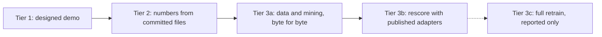

# Reproduce ai-symbiont

Three tiers, cheapest first. Every command runs from the repository root. You need `git` and
[`uv`](https://docs.astral.sh/uv/); nothing else is installed globally.

```bash
git clone <this repository> && cd ai-symbiont
git checkout product/repro-kit
uv sync --group dev        # once; downloads the pinned dependencies
```

Claim tags: [measured] is observed in our own run, [established] is known or true by construction,
[hypothesis] is a guess a run can support or refute.

| Tier | What it shows | Time and hardware | Needs |
|---|---|---|---|
| 1. See it work | The product speaks at a repeat failure, from a recorded session | about 1 second after `uv sync` on a laptop [measured] | nothing else: no GPU, no model, no API key, no network |
| 2. Check our numbers | Every headline claim recomputed from committed files | about 10 seconds on a laptop [measured] | nothing else |
| 3. Rerun the learning | The code-fix study's data and mining rebuilt from a pinned public dataset (3a); the published judge adapters rescored on the 924 items (3b; the nightly arm is not re-scorable yet); the full retraining is reported only (3c) | 3a 61 seconds [measured]; 3b about 51 minutes on an Apple M4 Pro laptop (MPS) [measured]; 3c 4 h 25 min on an Apple M4 Pro laptop (48 GB) [measured, from the study's run log] | 3a: internet. 3b: a Python with torch, the Llama base from Meta, the published judge adapters |



## Tier 1: see it work

```bash
scripts/reproduce/see_it_work.sh
```

This is a **designed demo**, not a measurement. The repository (`examples/ledger/`, a small
multi-currency ledger) and the recorded Claude Code session (`tests/fixtures/repro/ledger-session.jsonl`)
are synthetic and hand-written. The repository's rule is "amounts are integers in each currency's
minor units"; its four tests fail on purpose because the code assumes two decimals.

What the script does, with the product's own commands, in a throwaway home and data directory:

1. starts `symbiont serve` on port 47377 (loopback only);
2. `symbiont repo allow` (your yes for this repository) and `symbiont repo mine` (learn from its
   past sessions; here the one recorded session, in which the failing JPY invoice test was fixed);
3. `symbiont context add last "..."`, the user context: your own words, which lead the note;
4. runs the invoice test for real on a fresh checkout, so it fails the same way, and sends that
   failure to `symbiont hook PostToolUseFailure`, the hook Claude Code runs;
5. prints the note the hook returned and `symbiont why`.

Expected output (abridged):

```text
[symbiont] In this repo: Amounts are integers in each currency's minor units (JPY has none, BHD
and KWD have three); never multiply by 100. Last time, `pytest` failed with AssertionError (assert
500000 == 5000); it was fixed when you edited `ledger/invoices.py` to add `return int(total * 10 **
currency_exponent(currency))`, ... Check: run `pytest` and confirm it passes before moving on.
PASS: the repeat failure got a note about the earlier fix
```

It uses the exact-repeat rule: the same command failing the same way (same test, same normalized
message) as a stored failure. No model is involved [established]. The script exits 1 unless the
note carries both your words and the earlier fix. The test command carries `--tb=short -rN` on
purpose: a lesson keeps only the last 240 characters of the output, so a long pytest tail would
cut off the message line that identifies the failure, and nothing would match. That is a known
limit of the stored quote, not hidden by the demo.

## Tier 2: check our numbers

```bash
uv run python scripts/reproduce/check_numbers.py
```

Prints each headline claim beside the value recomputed from `results/*.json` and `prereg/`, with
`PASS`, `MISMATCH` or `STORED`. Exit status 1 on any `MISMATCH`. Expected last line:
`35 recomputed and equal, 2 stored in committed files but not recomputable, 0 MISMATCH` [measured].

| Claim | Recomputed from | How |
|---|---|---|
| Plug round 4, agree rule: 0 of 501 wrong, exact bound 0.73%; coverage 0.256 against 0.128, gain interval [0.033, 0.230] | `results/repro-cluster-tables.json`, `results/plug-r4-scored-primary.json`, `results/plug-r4-bounds.json` | exact Clopper-Pearson on the counts; the study's own repository-clustered bootstrap (`plug_r4_primary_stats.py`, 10,000 draws, seed 0) on per-repository counts |
| Code-fix study (SWE-smith): coverage 0.611 against 0.000, gain +0.611 [0.556, 0.666], 5 of 924 wrong, exact bound 1.26% | `results/repro-cluster-tables.json`, `results/plug-r4-smith-decision.json` | the same bootstrap on per-task counts; exact bound on 5 of 924 |
| Evolve tested card: +0.168 [0.063, 0.274] | `results/evolve-confirm.json`, `prereg/2026-11-01-evolve-final-card-confirm.md` | percentile bootstrap over the 40 per-map means (10,000 draws, seed 20261031 from the prereg); the file's prereg SHA-256 is checked against the prereg file |
| Evolve replication: +0.160 [0.106, 0.218] | `results/evolve-replication.json`, `prereg/2026-11-01-evolve-replication.md` | same |
| Core v3.1 (stopped early): -0.054 [-0.108, -0.014] | `results/core-v3-stopped-final.json`, `prereg/2026-10-31-core-v3.md` | the committed counts (0 better, 4 worse, 33 same; solve rates 2/37 and 4/37) fix every per-task difference at -0.5 or 0, so the prereg's bootstrap (10,000 draws, seed 20261101) is rerun exactly |

**What cannot be recomputed.** Two numbers are read from the committed files and compared with
the claim but not recomputed, and the output marks them `STORED`: the **case-level intervals of
the two Evolve tests** ([0.096, 0.243] and [0.095, 0.226]). They need per-game scores, which are not
committed. The Evolve claims read "better" only if both the map interval and the case interval sit
above zero, so those two readings rest on the stored case interval [established]. Model scores
(the judge's P(yes) per item) are also not committed; the per-cluster tables were derived from
them by `scripts/reproduce/export_cluster_tables.py`, which needs the study's local artifacts. So
tier 2 recomputes the statistics from per-cluster counts, not the model's scoring itself.

## Tier 3: rerun the learning

The code-fix study (`docs/research/2026-10-31-code-fix-lessons-result.md`, prereg
`prereg/2026-10-31-code-fix-lessons.md`) trains one nightly adapter per repository on public SWE-smith
trajectories and scores whether it names the right earlier fix at a later failure.

### Data terms

SWE-smith trajectories (`SWE-bench/SWE-smith-trajectories` on Hugging Face) are published under the
MIT license on the dataset card, and the dataset is not gated [measured, dataset card read on
2026-11-02]. Reading only the pydantic and moto rows for research is within those terms. We pin the
dataset by commit (`08e109b4a59eaeebf80e4675cd125d42e7ac99a4`), store nothing in the repository
(rows go to the gitignored `data/`), and commit counts, ids and hashes only.
**Disclosure: the bugs in SWE-smith are synthetic and injected.** The agents' mistakes while fixing
them are real. The study also infers failures from error text (observations carry no exit code) and
orders tasks by a seeded hash because they have no dates; the result document lists these limits.

### 3a. Rebuild the data and the mining (runs anywhere, 61 seconds)

```bash
scripts/reproduce/rerun_learning.sh data
```

Fetches only the pydantic and moto rows at the pinned revision (DuckDB range reads; the other
repositories' rows are never downloaded), checks the rebuilt per-repository files against
`results/repro-swe-smith-pins.json`, runs the study's own mining (`scripts/routea/plug_r4_smith.py
build` and `prep`), and requires the 924 items (462 recurrences and 462 negatives) and the 300
history lessons and 120 pairs to match the study's SHA-256 hashes. Expected last line:
`PASS: data stage reproduced byte for byte (61s)` [measured]. A mismatch exits non-zero and names
the file. This reproduces everything upstream of the model: what the judge is asked and what the
adapters would learn from.

### 3b. Rescore the judge arms with the published adapters

**What is and is not re-scorable.** The owner publishes only some of our LoRA adapters on Hugging
Face (`OWNER/Llama-3.2-1B-symbiont-judge-adapters`, where OWNER is the owner's Hugging Face handle, given in the pull request that introduced this file): the three round 3 judge seeds and the
general judge, no Llama weights, no merged copies, no training data. The two nightly per-repository
adapters are **withheld** pending a check of the terms on the model-written training targets.
So:

| Claim | Re-scorable from published weights? |
|---|---|
| The judge alone and the agree rule answer nothing on the 924 SWE-smith items (both coverage 0.000) | Yes: `rescore` below |
| Nightly arm: coverage 0.611, 5 of 924 wrong, interval [0.556, 0.666] | **No, not yet.** Verifiable from committed counts in tier 2, not re-scorable from weights |

Pins (SHA-256 per file, repository id, revision) are in `results/repro-adapter-pins.json`. You
obtain the base yourself, under Meta's license:

```bash
hf download meta-llama/Llama-3.2-1B-Instruct --local-dir data/repro/llama-3.2-1b-instruct   # accept Meta's license first
uv venv data/repro/torch-venv && uv pip install --python data/repro/torch-venv/bin/python torch transformers peft
export SYMBIONT_TORCH_PYTHON=$PWD/data/repro/torch-venv/bin/python LCAP_DEVICE=mps         # or cuda
scripts/reproduce/rerun_learning.sh data                                                    # 3a, makes the items
uv run --with huggingface_hub python scripts/reproduce/rerun_learning.py fetch-adapters --repo OWNER/Llama-3.2-1B-symbiont-judge-adapters --dest data/repro/adapters
uv run python scripts/reproduce/rerun_learning.py rescore --items data/repro/work/items \
  --base data/repro/llama-3.2-1b-instruct --adapters data/repro/adapters --work data/repro/rescore
```

`rescore` verifies every adapter file against its pin, scores the 924 items with the three judge
seeds, runs the study's frozen decision code for the judge alone and the agree rule, and requires
the result to equal the committed one: the same answered counts, the same coverage, the same
reading ("tie"). Exit 3 and `NOT RUN` mean a prerequisite is missing; it never reads as a pass.
Measured here (Apple M4 Pro laptop, MPS, adapters fetched from Hugging Face): 3029 s including the download check for 3 seeds x 9,240 queries; the agree rule and the judge alone both answered 0 of 924, coverage 0.000 and 0.000, reading tie, all four bands IN BAND [measured]. Part of that run shared the machine with other jobs, so expect less on an idle one.

For someone holding a full rerun's decision file (with a nightly arm), `compare` applies these
bands [hypothesis, that a retrained adapter lands inside them]:

| Band | Where it comes from |
|---|---|
| nightly coverage inside [0.556, 0.666] | the committed task-clustered interval |
| at most 33 of 924 wrong | the prereg's power section: the exact bound stays under 5% up to 33 |
| exact upper bound under 0.05 | the prereg's pre-set bar |
| the agree rule answers nothing | the committed result |

`compare` on the committed decision file reports every band `IN BAND` [measured].

### 3c. Full retraining: reported, not judge-runnable

The nightly adapters (withheld) were trained on targets written by Spark (situations invented and pairs
labeled by a language model; `plug_r4_scored_nightly.py invent`, `plug_r4_cont.py label`). Those
outputs are not published, so the training cannot be rerun from this repository. The study's run
log shows the training and scoring stage took 4 h 25 min on an Apple M4 Pro laptop (48 GB, MPS)
[measured]; one repository's adapter trained for about 1.6 hours [measured]. There is no
30-minute subset: a smaller training set would be a different experiment. `rerun_learning.sh
prerequisites ITEMS ARTIFACT_DIR` checks the round 3 adapters against the study's pins if you have
the owner's artifacts.

## Route B (the personal 30B model): reported, not judge-runnable

Needs a 30B model and about 100 GB of memory. Its pre-registration is
`prereg/2026-10-31-core-v3.md` with amendments 1 to 3 (`prereg/2026-11-01-core-v3-amendment-*.md`)
and its stopped-early result is `results/core-v3-stopped-final.json`. Tier 2 recomputes its numbers
from the committed counts; the training and the games themselves are not rerun here.

## What this kit does not do

- It does not rerun any scored study. Scored runs need a frozen prereg and the owner's hardware.
- It does not prove the demo's value on real work. Tier 1 is a designed demo on a synthetic repository.
- It does not commit data, transcripts or weights; everything fetched goes to the gitignored `data/`.
