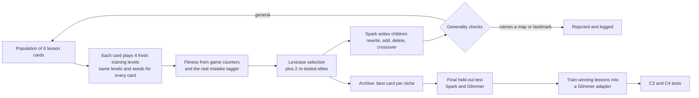

# Evolve: evolving lesson cards on Freedoom, a toy recursive self-improvement loop

Status: owner-approved direction (2026-10-28): medium size, Muse Spark Contributor tier as player and mutation author, spend cap $15 [established] (owner decision), the owner-proxy reviewer may approve and freeze the prereg. Domain: plays Freedoom via ViZDoom.

## 1. Intent

The owner wants the project to "inch toward the recursive version" of self-improvement, borrowing from natural selection, without overfitting: the result must hold on levels never seen during selection and under changed conditions. [hypothesis] A population of lesson cards, varied by a language model and selected on play, finds cards that make the model play better on new levels; the winning lessons then help a different model (Glimmer) too, and training them into Glimmer makes Glimmer a better author of the next variations. The last step is the recursion: the improver improves.

Plain Glimmer's starting point: in its 4 history games (MAP01 and MAP02, seeds 1 and 2) it reached the exit 0 times and made 44 tagged mistakes in 64 decisions (26 wasted moves, 9 rooms re-checked, 5 wall bumps, 4 rooms re-entered), with 17 kills and 0 deaths. [measured] It fights well and wanders, so the headroom is in getting through a level.

## 2. Roles

| Model | Role |
|---|---|
| Muse Spark 1.3, Contributor tier (`muse-spark-1.3-contributor`) | Player and mutation author during evolution. Fast and cheap; Freedoom self-play is Spark-safe; every call goes through `symbiont.egress` with the spend ledger and hard cap. |
| Glimmer (plain, served on the Strix) | Transfer test in the final held-out test: do Spark-evolved lessons help a different model? |
| Glimmer with a Freedoom adapter trained on the winning lessons | Tests C3 and C4 (section 3). |

Reasoning effort for play and for mutation is chosen from the probe (low vs medium for play) and fixed in the prereg.

## 3. Claims and how we will know

| Claim | Test | Label |
|---|---|---|
| C1 (primary): selection works | Best evolved card beats the best card from an equal-compute arm with no selection, on held-out levels, played by Spark | [hypothesis] |
| C2: robustness | C1 also holds in the harder condition alone (skill one step up, 10% of moves cut short) | [hypothesis] |
| C5: transfer | The evolved card beats no card when Glimmer plays the held-out levels | [hypothesis] |
| C4: learned becomes built in | Glimmer with the adapter (no card) does at least as well as plain Glimmer with the card | [hypothesis] |
| C3: the improver improves (exploratory) | Children written by the adapter Glimmer beat their parents more often than children written by plain Glimmer, judged by the same player | [hypothesis] |

Non-goals: general recursive self-improvement; speed-of-learning claims; coding (the same machinery is the next step if C1 holds).

Anti-goals, failures even if numbers rise: a winning card that memorizes levels; a gain from gaming the score; cherry-picked video (the before/after clip's level and seed are named in the prereg).

## 4. The loop

**Genome.** A lesson card: at most 8 lessons and 250 words, each in the three-part form (what went wrong, what to do instead, the check to make). Shorter cards win ties.

**Generation 0.** Six cards: empty, two built from the 21 lessons mined from Glimmer's history games, three written by Spark from prose summaries of those games (built from counters and tagger events, never raw logs).

**Variation.** Spark receives a parent card and a prose summary of that card's games and returns one of: a rewritten lesson, a new lesson for an observed mistake, a deleted lesson, a merge. Crossover takes lessons from two parents. Each child records parents and operator.

**Fitness, per game.** `1.0 × exit reached + 0.5 × share of the route to the exit covered − 0.02 × tagged mistakes − 0.5 × died`. Route share uses the navigation graph's start-to-exit distance, so standing still scores no progress. A shot fired with no enemy in view counts as a wasted move, closing the gap where firing in place skipped the tagger. Kills are not in fitness. Before the prereg is frozen, the formula is checked on generation-0 games: a scripted "stand still", "fire in place" and "spin" policy must each score below the empty card. [hypothesis] (the weights are a judgment call; this check guards them)

**Selection.** Lexicase over the generation's cases (each level and seed is a case), keeping cards that excel somewhere; the two best survive as elites and replay the new levels like everyone else. [established] (lexicase is a standard genetic-programming method)

**Archive.** Best card per niche across generations: card length (up to 4 lessons, 5 to 8) by focus (mostly navigation, mostly combat).

**Picking each arm's best card** for the final test: the highest mean training fitness over the last two generations' games, the same rule for both arms. Validation is not used for picking, so it stays a clean check.

## 5. Robustness: seven guards against overfitting

1. **Three-way level split.** Every fourth map (MAP04, MAP08 ... MAP32) is held out by the frozen level-split prereg. [established] (prereg/2026-10-27-act1-level-split.md) Of the 24 training maps, 4 are validation levels never used for selection or picking; selection draws from the other 20. Every level first passes a scripted-explorer navigation smoke test; failing levels are dropped and listed.
2. **A changing world.** Each generation draws 4 new levels and new seeds, a skill level from 2 to 4, and a 10% chance that any scripted move is cut short (built new in the move layer). [hypothesis] (design settings) Normal skill is 3, the harder condition is 4.
3. **Diversity.** Lexicase, re-tested elites and the niche archive keep several strategies alive.
4. **Short, general lessons.** Caps and the shorter-wins tie-break. A lesson naming a map, coordinate, sector, door number or monster position is rejected by a filter; a second judge call (Spark, high reasoning) rejects landmark descriptions ("second left to the blue-key room"); and a lesson stays in the winning card only if the card does at least as well with it as without on a level other than the one that produced it.
5. **Watch the gap.** Each generation the current best card plays the 4 validation levels; the generalization gap is logged, and if it widens two generations in a row evolution stops and keeps the last good generation.
6. **Noise check.** In generation 0, three cards each replay the 4 levels with a second seed. If the within-card spread exceeds the between-card spread, games per case double or the run stops: selecting on luck is the easiest way to overfit.
7. **Held-out last, rules first.** Held-out levels and the harder condition appear only in the final test, with rules frozen before generation 1.

## 6. Arms and the final scored test

| Arm | Player | Label |
|---|---|---|
| No card | Spark | floor |
| Best generation-0 card | Spark | reference |
| Best card of the no-selection arm (same population, same mutations, same games, parents chosen at random) | Spark | reference (equal compute) |
| Best evolved card | Spark | under test (C1, C2) |
| No card / best evolved card | Glimmer | floor / under test (C5) |
| Adapter Glimmer, no card | Glimmer | under test (C4) |

Each arm plays all held-out levels that pass the smoke test (up to 8) × 2 seeds × 2 conditions, up to 32 games per arm, paired by level, seed and condition, with a bootstrap over levels. [hypothesis] (design settings) Decision words better, tie, worse as in earlier preregs. With 8 levels the interval is wide; the prereg states the expected half-width from generation-0 variance before freezing.

C3 (exploratory): the same 6 parents each get 2 children from plain Glimmer and 2 from the adapter Glimmer; Spark plays all 24 children with their card on the same 4 levels; the measure is the share of children that beat their parent.

## 7. Video and visibility

Every held-out game is recorded with the stage panel. The before/after reel uses a held-out level and seed named in the prereg. A lineage page shows the winning card's family tree. Fitness, validation curves and the gap go on the progress page, beside Spark spend.

## 8. Budget and schedule

Generation size: 6 cards × 4 levels, both arms, plus 4 validation games: 52 Spark games. Six generations plus generation 0 and its noise check: about 380 games; the final test adds about 128 Spark games. At about 16 decisions per game this is roughly 8,000 Spark calls. [hypothesis] (estimate; the probe measures tokens and seconds per move) The reported Contributor-tier limit is about 100 requests per minute, so evolution takes a few hours. Cost at Contributor rates is a few dollars, under the hard $15 cap enforced by the spend ledger [established] (owner decision). Glimmer's part (final transfer arms and C3) is about 4 hours on the Strix, scheduled around Core's runs; adapter training is about 1 hour of GPU via the overnight queue with the memory guard.

## 9. Risks and stop rules

- Noise swamps selection: guard 6.
- Generality rejections above half of a generation: fix the mutation prompt before continuing.
- Spend cap reached: the ledger raises; the run stops and reports.
- Spark errors or refusals: logged with counts; a game with an unanswered move is marked ungraded, never scored as a loss or a win; more than 10% ungraded in a generation stops the run. [hypothesis] (design setting)
- Gap widens: stop early and report.

## 10. Reuse and build

Reuse: the merged recursive loop (rounds, ledger, manifest, allow-listed harvest), the Freedoom game loop, tagger, lesson builder, stage-panel recorder, the Spark player and spend ledger built for the probe, the Route B trainer and overnight queue.

New: population, lexicase, fitness with the wasted-shot fix, niche archive, generality filter and judge, cross-level lesson check, move-failure injection, lineage records, the no-selection control, picking rule, C3 test. Pure parts are unit-tested without any model; a dry run with a fake player runs end to end first.

Left to the builder: mutation prompt wording, niche boundaries, the route-share definition per level, where pure parts live within the package rules.
