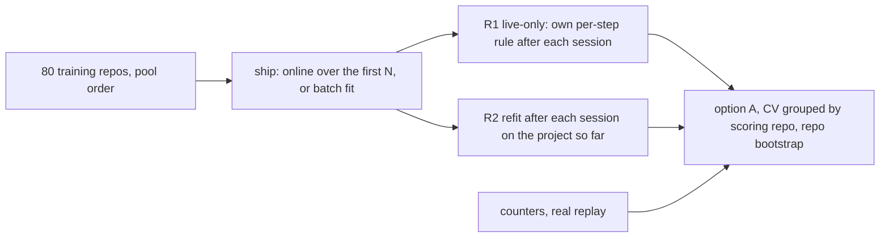
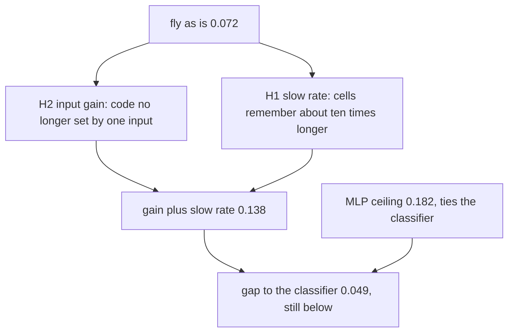

# Why the fly and DenseNet trail a batch classifier (T47, exploratory)

Status: exploratory, inside the 100-repository pool only (`results/repo-pool.json`). Pillow, dvc, conan and the T36 sqlglot test split are not read. Nothing here is a scored result.

Claim tags: [measured] = observed in our own run, [established] = from the literature or by construction, [hypothesis] = a guess a scored run can support or refute.

## Held-out set for the confirm run, declared before the ablation runs

The confirm run of the winning (learner, regime) uses the next three largest repositories of the same public dataset after Pillow, dvc, conan, sqlglot, the four unreadable ones and the 100 pool repositories, ranked by trajectory count from the per-repository counts file (counts only; no row of theirs was read) [measured]:

| repository | trajectories | tasks |
| --- | --- | --- |
| tox-dev/tox | 606 | 54 [measured] |
| dask/dask | 605 | 56 [measured] |
| pybamm-team/PyBaMM | 524 | 44 [measured] |

Whether the OpenHands reader accepts them is not checked yet; a refusal is reported at the confirm run, never replaced quietly [hypothesis].

One exploratory screen (fly variants, ranking only, pool scoring fold) ran before this declaration; it did not touch these repositories [measured].

## What was run

- Same pool, same 80/20 split, same option A scoring and repository-grouped bootstrap as the T46 curve; the counters row is the real replay and sits beside every row [established] (by construction).
- The fly and DenseNet rows are replayed from their per-step feature vectors; before scoring, the runner replays the existing fly and DenseNet through the real `offline.replay` on one training repository and requires the risks to agree (largest gap 3e-16 for the fly, 0 for DenseNet) [measured].
- Every variant is a new class beside the existing one (`core/fly_variants.py`, `core/dense_variants.py`, `core/input_gain.py`); the existing fly and DenseNet are unchanged [established].
- R2 refits: the fly and the existing DenseNet replay the project's sessions so far through their own rule three times from the shipped state (consolidation); DenseNet variants refit the readout in batch, pulled toward the shipped readout (Gaussian prior, strength 10, not tuned); "dense combined backprop" also refits the hidden layer (20 Adam steps); the logistic regression and the MLP refit in batch toward their shipped weights [established] (by construction).
- Wiring seeds 0 to 2 for every fly, DenseNet and MLP row; held-out counts are seed-averaged as in T46 [established].

## Ablation table (80 training repositories, 20 scoring)

Option A with a heads-up gain of 1 (the T46 recommendation, `a_heads_up_gain_1`): net value per 100 steps with its 95% repository-bootstrap interval, precision, notes per 100 steps and ranking AUC. Roles: counters and logistic regression are references, the MLP is a ceiling probe, every other row is under test. All rows [measured].

| learner | regime | net / 100 steps | precision | notes / 100 | AUC |
| --- | --- | --- | --- | --- | --- |
| counters (reference) | R1 | 0.063 [0.011, 0.122] | 0.24 | 1.33 | 0.541 [measured] |
| logistic regression (reference) | R1 | 0.187 [0.117, 0.262] | 0.31 | 1.37 | 0.659 [measured] |
| logistic regression (reference) | R2 | 0.142 [0.083, 0.212] | 0.31 | 1.03 | 0.678 [measured] |
| MLP ceiling probe | R1 | 0.182 [0.114, 0.251] | 0.33 | 1.13 | 0.663 [measured] |
| MLP ceiling probe | R2 | 0.157 [0.092, 0.229] | 0.32 | 1.02 | 0.688 [measured] |
| fly as is | R1 | 0.072 [0.025, 0.124] | 0.26 | 1.02 | 0.658 [measured] |
| fly as is | R2 | 0.073 [0.025, 0.126] | 0.25 | 1.08 | 0.660 [measured] |
| fly H1 slow rate (0.01) | R1 | 0.102 [0.056, 0.151] | 0.29 | 0.87 | 0.661 [measured] |
| fly H1 two compartments (0.1 and 0.01) | R1 | 0.086 [0.041, 0.136] | 0.28 | 0.89 | 0.666 [measured] |
| fly H2 input gain | R1 | 0.110 [0.054, 0.169] | 0.29 | 0.93 | 0.681 [measured] |
| fly H3 two valence | R1 | 0.068 [0.026, 0.115] | 0.26 | 0.88 | 0.659 [measured] |
| fly H1 slow + H2 | R1 | 0.138 [0.078, 0.204] | 0.31 | 1.00 | 0.688 [measured] |
| fly H1 slow + H2 | R2 | 0.106 [0.046, 0.168] | 0.28 | 1.05 | 0.684 [measured] |
| fly H1 + H2 (two compartments) | R1 | 0.127 [0.068, 0.189] | 0.31 | 0.94 | 0.690 [measured] |
| fly combined (H1 + H2 + H3) | R1 | 0.136 [0.076, 0.199] | 0.31 | 0.99 | 0.690 [measured] |
| fly combined (H1 + H2 + H3) | R2 | 0.122 [0.061, 0.185] | 0.30 | 0.96 | 0.685 [measured] |
| DenseNet as is | R1 | 0.040 [0.008, 0.076] | 0.23 | 1.20 | 0.582 [measured] |
| DenseNet as is | R2 | 0.053 [0.020, 0.091] | 0.24 | 1.15 | 0.589 [measured] |
| dense plain delta (no calibrator, unweighted) | R1 | 0.075 [0.032, 0.121] | 0.25 | 1.12 | 0.653 [measured] |
| dense D1 gain | R1 | 0.102 [0.053, 0.154] | 0.28 | 0.96 | 0.659 [measured] |
| dense D1 gain + fan-in scale | R1 | 0.071 [0.026, 0.117] | 0.25 | 1.12 | 0.656 [measured] |
| dense D2 rate 1 | R1 | 0.042 [0.015, 0.069] | 0.23 | 1.16 | 0.561 [measured] |
| dense D2 rate 1, decaying | R1 | 0.083 [0.038, 0.129] | 0.27 | 1.00 | 0.669 [measured] |
| dense D3 class-balanced | R1 | 0.061 [0.028, 0.098] | 0.24 | 1.17 | 0.618 [measured] |
| dense D4 skip | R1 | 0.017 [-0.017, 0.050] | 0.21 | 1.22 | 0.531 [measured] |
| dense D4 512 units | R1 | 0.067 [0.025, 0.113] | 0.25 | 1.17 | 0.655 [measured] |
| dense combined (D1 to D4) | R1 | 0.119 [0.076, 0.163] | 0.29 | 1.02 | 0.614 [measured] |
| dense combined, readout refit | R2 | 0.105 [0.046, 0.170] | 0.25 | 1.54 | 0.502 [measured] |
| dense combined, backprop refit | R2 | 0.134 [0.076, 0.201] | 0.31 | 0.95 | 0.645 [measured] |

R2 rows of the single-change variants, the T46 primary option (`a_tiers_boundary_budget`) and every paired difference are in `results/fly-ablation-exploratory.json` [measured]. Under the primary option the best fly row (H1 slow + H2, R1) earns 0.075 [0.033, 0.119] against the classifier's 0.084 [0.026, 0.142] and the existing fly's 0.006 [-0.013, 0.027] [measured].

Paired differences, same draws [measured]:

- fly as is minus counters 0.008 [-0.027, 0.043]: a tie, as in T46 [measured].
- fly H1 slow + H2 minus counters 0.075 [0.024, 0.131]; minus the classifier -0.049 [-0.092, -0.008] [measured].
- fly combined minus the classifier -0.051 [-0.109, 0.005] [measured].
- dense combined backprop (R2) minus the classifier -0.053 [-0.100, -0.010] [measured].
- MLP minus the classifier -0.005 [-0.038, 0.028] (R1): a tie [measured].

## What held the fly back

**H2 input scaling held, and it is the largest single cause.** On raw inputs the session's log line count is nonzero on 62% of steps, and on those steps 97% of the 259 active cells are cells wired to it; random pairs of steps share 35% of their active cells and only 0.66 distinct codes exist per distinct input [measured]. With projection-neuron gain control (centered, scaled, capped at 3 spreads; fit on training repositories) the share wired to that input falls to 14%, pair overlap to 7% and distinct codes per input rise to 0.85 [measured]. Value 0.072 to 0.110, AUC 0.658 to 0.681 [measured].

**H1 forgetting held.** With rate 0.1 a cell's e-folding memory is about 57 of its updates, while the median cell receives about 2,900 updates over 80 repositories, so it remembers 2% of its outcomes; at rate 0.01 the memory is about 595 updates (20%) [measured]. A slow rate alone: 0.102; two compartments (fast plus slow) only 0.086, because the fast compartment's noise stays in the average [measured]. With gain on, every cell fires (median 18,000 updates per cell), and the slow rate adds the most: gain plus slow rate 0.138, AUC 0.688 [measured].

**H3 one-sided readout did not hold.** Approach and avoid output neurons give 0.068 against 0.072, and add nothing on top of gain and two compartments (0.136 against 0.127, within noise) [measured]. Knowing "safe" was not what the fly lacked [hypothesis].

**H4 code quality: no zero-drive problem, but heavy tie-breaking.** No active cell has zero drive [measured]. On raw inputs, though, 47% of active cells are chosen by the fixed jitter among cells tied at the cutoff drive; with gain control the share is 0 [measured]. The gain fix removes this, so no separate inputs-per-cell or sparsity variant was run; the fly's published counts (86, 5,177, 7, 5%) are kept in every row [established].

**What remains.** The best fly row still trails the classifier by 0.049 [0.008, 0.092] [measured]. The MLP ceiling probe ties the classifier (-0.005 [-0.038, 0.028]), so these 86 features hold little signal beyond a linear one [measured]. The rest of the gap is likely the readout: a per-cell weight averaged over 259 cells cannot weigh one input against another the way a fitted linear model does [hypothesis].

## What held DenseNet back

- **The existing class's own rule is the largest cost.** The same random layer with a plain delta rule (no calibrator, no false-alarm weighting) earns 0.075 against 0.040, AUC 0.653 against 0.582 [measured].
- **D1 saturation is real but not the cause.** 65% of hidden units sit at |tanh| above 0.95 on raw inputs; gain alone raises that to 74% yet lifts value to 0.102; gain with a fan-in scale cuts saturation to 1.7% and earns only 0.071 [measured]. Input scale matters, saturation does not [hypothesis].
- **D2 step size:** rate 1 hurts (0.042, AUC 0.561); rate 1 decaying earns 0.083 [measured]. The readout step was not too small [measured].
- **D3 class weighting hurts** (0.061) [measured].
- **D4 capacity:** a skip from raw inputs diverges online (0.017); 512 units add nothing (0.067) [measured].
- **Combined** (D1 to D4): 0.119; with a backprop refit of the hidden layer between sessions 0.134, the best DenseNet row, still below the classifier by 0.053 [0.010, 0.100] [measured].

## Regimes: R1 live-only against R2 refit between sessions

Net value per 100 steps at 80 training repositories, option A gain 1. Refit wall time is per refit, measured on the laptop CPU (14 cores, 10 busy workers, so an upper bound for one refit alone); 2,691 refits per learner (897 for the single-seed classifier) [measured].

| learner | R1 | R2 | R2 refit mean / p95 / max (s) |
| --- | --- | --- | --- |
| counters (reference) | 0.063 | no refit | none [established] |
| logistic regression (reference) | 0.187 | 0.142 | 0.004 / 0.014 / 0.024 [measured] |
| MLP ceiling probe | 0.182 | 0.157 | 0.032 / 0.085 / 0.145 [measured] |
| fly as is | 0.072 | 0.073 | 0.025 / 0.051 / 0.078 [measured] |
| fly H1 slow + H2 | 0.138 | 0.106 | 0.027 / 0.056 / 0.088 [measured] |
| fly combined | 0.136 | 0.122 | 0.125 / 0.263 / 0.407 [measured] |
| DenseNet as is | 0.040 | 0.053 | 0.053 / 0.108 / 0.206 [measured] |
| dense D1 gain | 0.102 | 0.115 | 0.004 / 0.010 / 0.023 [measured] |
| dense combined, readout refit | 0.119 | 0.105 | 0.276 / 0.536 / 0.817 [measured] |
| dense combined, backprop refit | 0.119 | 0.134 | 0.211 / 0.420 / 0.642 [measured] |

Every refit fits the few-seconds laptop budget [measured]. R2 helps DenseNet a little (readout or hidden layer refit) and nothing else: it lowers the classifier and the MLP by 0.02 to 0.05 although it raises their AUC (0.659 to 0.678, 0.663 to 0.688) [measured]. A per-project refit moves each project's risk scale, while option A's thresholds are chosen across repositories, so a better ranking inside a project can price worse [hypothesis]. The same may explain the readout-refit row's pooled AUC of 0.50 at a positive value [hypothesis]. Fly consolidation (three passes) adds nothing: the slow compartment already integrates the project [hypothesis].

## Does the fixed fly use more data?

Option A gain 1, R1, by number of training repositories (curve run on the Strix CPU; 80 from the main run):

| N | counters | logistic | fly as is | fly H1 slow + H2 | fly combined | dense combined |
| --- | --- | --- | --- | --- | --- | --- |
| 1 | 0.084 | 0.122 | 0.076 | 0.050 | 0.097 | 0.093 [measured] |
| 10 | 0.081 | 0.165 | 0.070 | 0.156 | 0.146 | 0.115 [measured] |
| 80 | 0.063 | 0.187 | 0.072 | 0.138 | 0.136 | 0.119 [measured] |

The existing fly is flat from 1 to 80 repositories; with gain control and a slow rate it doubles from 1 to 10 and then flattens, as the classifier's curve does [measured]. At 10 repositories gain plus slow rate ties the classifier (-0.009 [-0.052, 0.032]) and beats counters by 0.076 [0.025, 0.134] [measured]. The slow rate alone is weak with one repository (0.050), where the fast compartment of the combined fly carries it (0.097) [measured]. The fly's flat curve was its forgetting and its input code, not the data [hypothesis] (supported by these rows, exploratory).

## Recommendation

- **Best (learner, regime): logistic regression, R1** (ship a batch fit, no per-project refit): 0.187 [0.117, 0.262], the highest row; the MLP ties it and is not a filler (spec 4.5) [measured]. The confirm run scores it on tox, dask and PyBaMM, with counters and the fly beside it [hypothesis].
- **Fly variant: "fly combined", R1**: projection-neuron gain control (capped), a fast and a slow output compartment, approach and avoid output neurons. It was declared before the runs, it is the steadiest fly over 1, 10 and 80 repositories (0.097, 0.146, 0.136), it beats counters at 10 and 80, and it nearly doubles the existing fly [measured]. Gain plus slow rate ties it at 10 and 80 and is simpler, but it was added after the first run and is weak at 1 repository [measured]. The avoid side adds nothing measurable and can be dropped if the confirm run agrees [hypothesis].
- **DenseNet:** drop the calibrator and false-alarm-weighted rule and add input gain before trusting its row; its best form (combined, backprop refit) still trails the classifier [measured].
- Demo line unchanged: "a learner built on the fly's real circuit, next to plain counters and a standard classifier" [established].

## Caveats

- Exploratory: one 20-repository scoring fold, chosen settings seen on it; the confirm set above guards the choice [established] (by construction).
- A first full run used an uncapped gain and classifier l2 = 100 (the T46 docstring's example; the committed T46 curve used 1000). The uncapped run showed the combined DenseNet readout diverging (weights near 270) because rare flags were scaled to about 200 spreads; the cap and l2 = 1000 were fixed before the rows above. Uncapped, fly H2 earned 0.117 and fly combined 0.119 [measured].
- The fly H1 slow + H2 row was added after that first run [established].
- Pool labels carry no blast-radius signal and no hub filter (no checkout), as in T46 [established].
