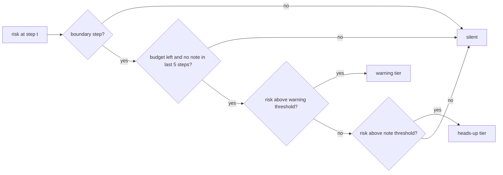

# How a note earns the right to speak (T46)

Status: design, exploratory evidence on TRAIN only. Nothing here changes the T36 verdict (`results/penalized-selection.json`: no live warner at c = 0.5 [measured]).

Claim tags: [measured] = observed in our own run, [established] = from the literature or by construction, [hypothesis] = a guess a scored run can support or refute.

## Why T36 found a cliff

T36 counted every warned step as its own alarm and charged c = 0.5 for each false one (break-even precision 0.33 [established] (algebra)). A learner that is right about a trouble spell but says so on five steps in a row is paid five times and fined five times. At c = 0.25 the fly earned +0.90 per 100 steps (CI 0.003 to 1.87) warning on 37% of steps at precision 0.22; at c = 0.5 it warned on 0.06% of steps and earned about 0 [measured] (T36). The fly's precision sits between the two break-even points (0.20 and 0.33), so the threshold either opens wide or shuts [hypothesis]. A product does not speak on every step: it speaks at a pause, a few times per task, once per problem. The metric should price the note that a harness would actually show, not every step a score crosses a line.

## What the literature says

- Tiered clinical alerts: moderate-severity alerts were accepted 29% of the time at a site with tiers versus 10% without (Paterno 2009); untiered pop-ups are overridden about 90% of the time [established].
- Proactive suggestions at workflow boundaries (after a commit) were taken up far more than mid-task ones in a five-day field study (arXiv 2601.10253) [established].
- Burden grows with notification count; fewer nudges reach the same goal (arXiv 2311.09483; Gan et al., AISTATS 2024) [established].
- Decision-curve analysis judges a model over a range of costs and reports where it beats treat-all and treat-none (Vickers and Elkin 2006) [established].
- Conformal risk control picks a threshold that bounds an expected loss with a finite-sample guarantee, if the loss is monotone (arXiv 2208.02814) [established].

## The options

Shared definitions (all options, all fixed before any number was seen):

- Boundary step: the step's record is a failed command (the miner's rule, so an empty grep is not a failure), or an edit of a file this session already edited and applied.
- Trouble spell: a maximal run of consecutive steps whose label is true (a filtered pain point within the next five steps, as T36).
- Cooldown: after a note, no note for the next 5 steps (the label window), so a live harness approximates "one note per trouble spell" without knowing where a spell ends.
- Notes are spent online: a budget goes to the first qualifying steps, never to the riskiest steps in hindsight.

| | cost model | runner change | delivery change | risk | scored by |
|---|---|---|---|---|---|
| **A. tiers + boundaries + budget** (primary) | warning: true +1, false -0.5; heads-up: true +0.75, false -0.25 [hypothesis: a quiet note helps less but costs less] | two thresholds chosen on TRAIN; boundary marks per step; budget 2 per session; cooldown 5 | service picks the tier; hooks speak only at PostToolUse of a failed command and PreToolUse of a re-edit; the heads-up tier is a one-line status, the warning tier the full note | the heads-up gain is an assumption, so a sensitivity at 0.5 and 1.0 is reported; boundaries may miss trouble that starts mid-flow | net value per 100 steps, precision, spells hit |
| **B. per spell** | the first note inside a spell gains +1 once; repeats in the spell are free; every false note -0.5 | spell ids per step; score counts spells hit | none beyond dedup (the service keeps one note per spell) | rewards a learner that warns early and keeps warning inside the spell; false notes still per step | spell value per 100 steps |
| **C. budgeted top-k** | no cost constant: every learner gets k notes per session (k = 1, 2, 3) | threshold by conformal risk control on TRAIN tasks: expected false notes per session at most 0.25 of the budget | service enforces k per session and the cooldown | the false-note loss is not strictly monotone under a budget; the running maximum keeps the bound valid but conservative | precision and net value at c = 0.5 at that budget; the realized false notes per session check the bound |
| **D. measured cost** | c is measured by T20's placebo arm (how far a wrong note derails the model) instead of assumed | the decision curve over c in 0.1 to 1.0 is reported per learner | none until T20 measures c | T20 has not run; until then D says only where each learner is useful | the c values where a learner's interval is above 0 |
| **E. fallback** | no warnings | none | recall-only plus encourage notes (T42); the demo shows recall answering "what went wrong last time I touched this?" | the fly and DenseNet appear only as recall engines and as rows in the honest table | the recall@3 row, beside counters |

## Exploratory evidence (TRAIN only)

Run: `scripts/offline/run_note_cost.py` on the Strix CPU. The T36 TRAIN split only (193 tasks, 1,913 sessions, same split seed 20261029, replay order, hub `sqlglot/__init__.py`, labels and learning cost 0.5) [measured]. No TEST session was replayed or read for a metric. Every learner replays TRAIN online once (each step's risk is read before the learner sees that step's outcome); five task-grouped folds then pick each setting on four folds and count the fifth, so each task is scored once by settings that never saw it. Intervals: 2,000 task-bootstrap draws, seed 20261029. Results: `results/note-cost-exploratory.json`, labeled exploratory. Thresholds come from a 40-point quantile grid, not every distinct risk as in T36.

Net value per 100 steps, 95% interval [established] (task bootstrap); a row "earns notes" when the lower bound is above 0. Floors in every option: warn never (0 by construction) and a note at every allowed step.

| option | counters (reference) | fly (under test) | DenseNet (under test) | note-at-every-allowed-step (floor) |
|---|---|---|---|---|
| T36 rule, per step, c = 0.5 | -0.003 [-0.010, 0.000] | -0.005 [-0.021, 0.005] | -0.001 [-0.001, 0.000] | -26.2 [measured] |
| A, heads-up gain 0.75 (primary as built) | **0.021 [0.004, 0.040]** | 0.011 [-0.002, 0.025] | 0.003 [-0.011, 0.017] | -0.21 [measured] |
| A, heads-up gain 1.0 (heads-up c = 0.25 as in the brief) | **0.090 [0.061, 0.121]** | **0.070 [0.044, 0.098]** | **0.061 [0.037, 0.086]** | -0.21 [measured] |
| A, heads-up gain 0.5 | 0.000 (silent) | -0.001 [-0.002, 0.000] | -0.001 [-0.002, 0.000] | -0.21 [measured] |
| A, one tier only (warning, c = 0.5) | 0.000 (silent) | -0.001 [-0.002, 0.000] | -0.001 [-0.002, 0.001] | -0.21 [measured] |
| B, per spell, c = 0.5 | 0.000 (silent) | 0.000 (silent) | 0.000 (silent) | -39.6 [measured] |
| C, budget 1, risk bound 0.25 | -0.054 [-0.073, -0.035] | -0.053 [-0.065, -0.041] | -0.049 [-0.057, -0.040] | -0.36 [measured] |
| C, budget 2 | -0.116 [-0.151, -0.083] | -0.115 [-0.134, -0.096] | -0.088 [-0.103, -0.073] | -0.57 [measured] |
| C, budget 3 | -0.185 [-0.234, -0.136] | -0.162 [-0.189, -0.137] | -0.148 [-0.168, -0.127] | -0.73 [measured] |

What the table says:

- Boundaries carry signal on their own. A note at every boundary step is right 23% of the time, against 16% for every step [measured]. That lifts the floor from -26 to -0.21 per 100 steps, but does not make it positive [measured].
- In option A almost every note is a heads-up (heads-up share 0.996 to 1.0) [measured]. On TRAIN no learner reaches the 0.33 precision a warning needs at c = 0.5, even at boundaries (precision 0.25 to 0.28) [measured]. Whether A earns anything depends on what a heads-up is worth: at gain 1.0 (a false heads-up costs a quarter of a right one) all three learners earn; at 0.75 only counters do, by a hair; at 0.5 nobody speaks [measured]. The heads-up gain is the assumption that decides A [hypothesis].
- Counters lead. With heads-up gain 1.0: fly minus counters -0.020 [-0.043, 0.003] (tie), DenseNet minus counters -0.029 [-0.051, -0.007] (worse), fly minus DenseNet 0.009 [-0.005, 0.023] (tie) [measured]. No claim that the fly's circuit earns a gain.
- The earning is small: about 1.1 to 1.2 notes per 100 steps, 1.5 per session, 11% of trouble spells get a note, 0.07 to 0.09 net per 100 steps [measured].
- B makes every learner silent at c = 0.5 [measured]: scoring once per spell removes the reward for repeated true warnings, while false warnings still count per step.
- C keeps its promise and nothing more: realized false notes per session are 0.22 (k = 1), 0.42 to 0.47 (k = 2) and 0.65 to 0.71 (k = 3), under the bounds 0.25, 0.5 and 0.75 [measured]. But the first steps that clear the threshold are right only 12% to 17% of the time, about the base rate, so the value is negative for every learner [measured]. Bounding false alarms does not make notes useful.
- D (decision curve, per-step rule): every learner is useful at c = 0.1 and 0.2 and none at 0.3 or above [measured]. At c = 0.2 the fly's point estimate (3.05 per 100 steps) is above DenseNet (1.50) and counters (0.64); the paired gap at c = 0.2 was not computed in this run [measured point estimates, no interval].

## Fresh data for a scored run

Yes, there is data T36 never read. The public source `nebius/SWE-rebench-openhands-trajectories` holds 67,074 trajectories on 1,823 repositories; T36 used only `tobymao/sqlglot` (2,678 trajectories, 275 tasks) [measured] (a count of the `repo` column only; no trajectory of another repository was read). The next largest are `python-pillow/Pillow` (1,328 trajectories, 126 tasks), `iterative/dvc` (846, 68) and `conan-io/conan` (692, 67) [measured]. Other pools checked: `sessions_dropped_taskless` is 0 in T36 [measured]; every sqlglot row of this dataset is already in T36; the desktop `runs-wide` directory holds 47 mini-SWE-agent trajectories of Glimmer on sqlglot tasks [measured] (file names only), too few, a different harness and model, and on tasks T36 already split.

Proposal for the owner (not decided here): a scored run on repositories chosen by a rule fixed before export: the three repositories with the most trajectories after `tobymao/sqlglot`. Each is split by task (test fraction 0.3, seed 20261029) and replayed on its own, as the product works per project. No metric on them is computed before the prereg is frozen. The fallback, if the owner refuses a new download, is a new split seed on sqlglot declared before looking, labeled as a re-use of data the owner has seen.

## Hold-out declared before any cross-repository training

Declared on 2026-10-28 before any pool row is exported or any cross-repository learner is trained: `python-pillow/Pillow`, `iterative/dvc` and `conan-io/conan` are held out for a later scored run. Their rows are never exported for training and never read, except as counts; `symbiont.eval.repo_pool.HELD_OUT` names them and the exporter refuses them. `tobymao/sqlglot` is excluded from the pool too, because its T36 test split must not be read.

## Recommendation

Recommend **A with the brief's prices**: notes only at boundary steps, at most 2 per session, a 5-step cooldown, a heads-up tier (true +1, false -0.25) and a warning tier (true +1, false -0.5), thresholds chosen on each repository's TRAIN. Score it on the fresh repositories under `prereg/2026-10-28-note-cost-DRAFT.md`, with the decision curve (D) and the heads-up gain 0.75 and 0.5 rows as sensitivity. Why: it is the only option where any learner earns notes on TRAIN, and boundaries plus a quiet tier are what the literature says lets an alert be heard [established]. What it cannot do: turn the fly into a winner. On TRAIN, counters lead and the fly ties them [measured]. The honest demo line is "a learner built on the fly's real circuit, next to plain counters, at the moments a hook can speak", not "the fly warns better".

The price of a heads-up is the assumption that decides A [hypothesis]; it should be measured, not chosen. T20's placebo arm (D) is the way: if a wrong heads-up derails the model less than a quarter of what a right one helps, A stands; if not, E.

If the fresh run gives no live warner, ship E: recall-only plus encourage notes (T42), with the counters and fly rows printed side by side. The demo shows recall answering "what went wrong last time I touched this file?" and the boundary heads-up as a dashboard replay, not live.

Choice made after seeing TRAIN: the brief named a heads-up c of about 0.25. The build first used gain 0.75 as a guess. Gain 1.0 is primary here because it is the brief's value and because TRAIN favored it. The fresh-data run exists to guard against that choice [established] (by construction).
