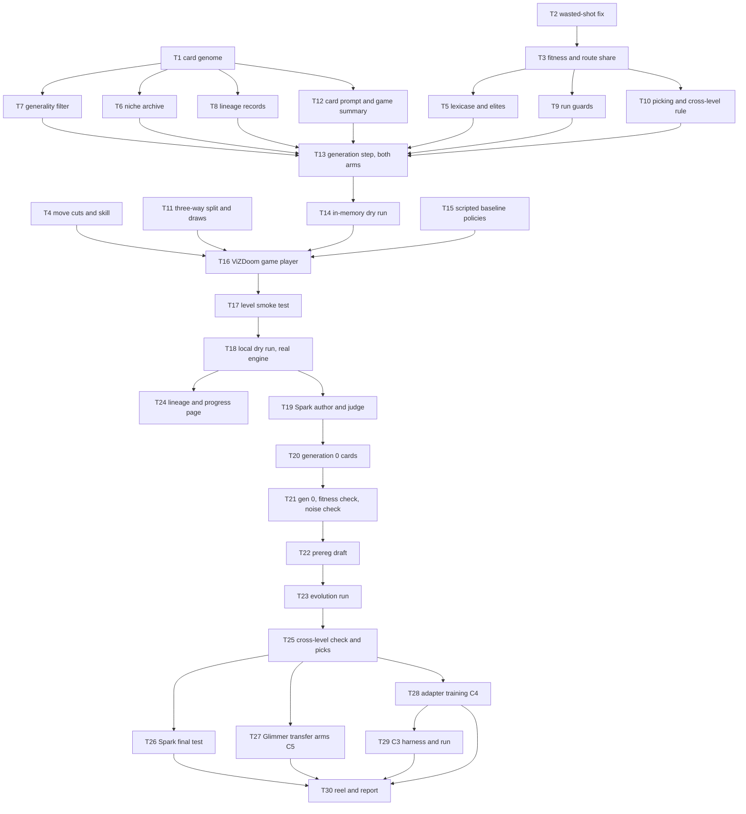

# Evolve: implementation plan

Status: plan for the owner-approved design `docs/design/2026-10-28-evolve.md` (commit 4582bd8). Plays Freedoom via ViZDoom. Claim tags: every number below is tagged; estimates are [hypothesis] unless they quote a measured rate.

Goal of the ordering: a dry run with a fake player works end to end, with no model and no network, before the first Spark call; then a cheap generation 0 gives the numbers the prereg needs; then the frozen prereg; then evolution, the scored test and the Glimmer half. A demoable, honest artifact (lineage page and progress curves, labeled exploratory or scored) exists from the dry run on, so the hackathon demo never waits for the last task.

## 0. Ground rules for every task

- **Branch.** Build on a new branch `evolve/build` cut from `origin/main` (it carries the recursive loop of PR #36 and META2). Tasks that call Spark (T19 on) also need `act1/learning` merged (Spark player, `symbiont.egress.spark.SparkSession`, `symbiont.egress.spend.Ledger`, `SpendCapError`, `Effort`, `Tier.CONTRIBUTOR`). Pure tasks do not wait for it.
- **Where code lives.** Pure parts go in `src/symbiont/act1/` as flat modules (act1 may import records, core, egress and `eval.budget`; a new act1 module is already covered by `.importlinter`'s `symbiont.act1.**` contracts, so no gate file changes). Each new pure module is added to `PURE_FILES` in `tests/act1/test_purity.py` (a test, not a gate). Periphery parts (ViZDoom, files, clock, Spark, Glimmer) go in a new `scripts/evolve/` with its own `AGENTS.md`, importing siblings the way `scripts/loop/` does (`script_paths.add_script_dirs()` style), tested from `tests/scripts/test_evolve_*.py`.
- **Caps.** act1 counts as "rest of `src/`": functions at most 40 lines and CCN 12, at most 5 parameters, nesting 3, files at most 400 lines, classes at most 12 public methods. No function takes two booleans: every switch is a `StrEnum` (named variants below). No `except: pass`; every refusal raises a named error.
- **Privacy and egress.** Every Spark call goes through `SparkSession.chat` (Contributor lane, `post_json`, ledger checked before the call). Payloads declare `Provenance` for Freedoom self-play with `spark_safe=True`; nothing from a private session or SWE-chat is ever in a Spark prompt. Logs carry `len(prompt)`, never prompt text. Glimmer calls go through `glimmer.chat_reply` (`Endpoint.LOCAL_GLIMMER`).
- **Hold-out.** Every training or validation game calls `levels.require_training(level)` before the engine loads. A held-out level is played only by the final-test runner, which calls `symbiont.eval.prereg_git.require_frozen` first.
- **State and results.** Run state (cards with text, lineage, per-game results) lives outside the repo in `~/symbiont-runs/evolve/<run>/state.json` (mode 0600), written atomically per game so a crash resumes. Only counts, ids and labels go to `results/evolve-*.json`.
- **Gates.** Each task ends with `uv run pytest -q` green and `scripts/gates/run.sh fast` green. No edit to gate files, waivers, thresholds or hooks. American spelling.
- **TDD.** Each task writes the listed tests first, sees them fail for the stated reason, then writes the code.

## 1. Order, parallel lanes and what needs a model

| Lane | Tasks | Needs | Can run in parallel with |
|---|---|---|---|
| A (pure, airplane mode) | T1 to T12 | nothing | each other, after T1 for T6, T7, T8, T12 and after T2 then T3 for T5, T9, T10 |
| B (pure orchestration) | T13, T14 | nothing | T15, T4 work in lane A |
| C (local engine) | T15 to T18, T24 | ViZDoom on the laptop, no network | T19 (once T18's interfaces are fixed) |
| D (Spark) | T19 to T23, T25, T26 | Spark Contributor, `act1/learning` merged | T24 |
| E (Glimmer, GPU) | T27, T28, T29 | Glimmer on the Strix; GPU via `ops/gpu_run.sh` and the overnight queue | T26 (different machine and budget) |

Model use and cost per task. Planning rates [hypothesis]: a player call is about 1,100 prompt and 600 to 1,500 completion tokens, so about $0.0004 at Contributor rates ($0.10 in and $0.20 out per million, from the spend ledger's price table, itself unconfirmed [hypothesis]); a mutation call about $0.0005 [hypothesis]; a judge call at high effort about $0.001 [hypothesis]; 16 decisions per game. Glimmer: 32 s per decision serial, 1.3x slower per slot with 2 slots busy [measured] (scripts/loop/estimate.py).

| Task | Spark calls | Spark cost | Glimmer | GPU |
|---|---|---|---|---|
| T1 to T18, T24 | 0 | $0 [established] (no model is called) | 0 | 0 |
| T19 | 0 (fake transport); 3 live smoke calls | under $0.01 [hypothesis] | 0 | 0 |
| T20 | 3 author calls | under $0.01 [hypothesis] | 0 | 0 |
| T21 | 40 games (24 gen 0, 12 noise, 4 validation): 640 calls | about $0.26 [hypothesis] | 0 | 0 |
| T23 | 312 games (6 generations x 52): 4,992 calls, plus about 48 author and 48 judge calls | about $2.10 [hypothesis]; double if the noise check doubles games per case | 0 | 0 |
| T25 | 36 games: 576 calls | about $0.23 [hypothesis] | 0 | 0 |
| T26 | 128 games: 2,048 calls | about $0.82 [hypothesis] | 0 | 0 |
| T27 | 0 | $0 [established] | 32 games, 512 decisions: about 3 h [hypothesis] (measured rate) | 0 |
| T28 | 0 | $0 [established] | install and verify, then the C4 arm: 16 games, about 1.5 h [hypothesis] | about 1 h overnight [hypothesis] |
| T29 | 120 games: 1,920 calls, plus 24 judge calls | about $0.80 [hypothesis] | 24 author calls, about 0.5 h [hypothesis] | 0 |
| Total | about 10,300 calls | about $4.2, at most about $6.5 with doubling, under the $15 cap [hypothesis] | about 5 h [hypothesis] | about 1 h [hypothesis] |

Each Spark task runs under its own run cap (`caps_from_environment(run_usd=...)`, values in the task) inside the $15 total [established] (owner decision), so one runaway phase cannot spend the others' budget.

Target dates [hypothesis]: lane A and B Oct 29 to 30; lane C Oct 30; T19 to T22 Oct 31; T23 Oct 31 to Nov 1; T25 to T26 Nov 1 to 2; T27 to T29 Nov 2 to 3; T30 Nov 3 to 4 (deadline Nov 4, 6 PM PT).

## 2. Rulings on gaps the design leaves open

Each ruling: what, why, cost if wrong. The prereg draft (T22) repeats the ones that bind a scored run so the reviewer can overrule them before the freeze.

1. **Glimmer arms play the normal condition only (16 games per arm, not 32).** Why: three Glimmer arms at 32 games are 1,536 decisions, about 8.9 h at the measured rate [hypothesis] (measured rate), twice the design's 4 h; C5 and C4 are transfer claims, and robustness (C2) is tested on Spark. Cost if wrong: C5 and C4 say nothing about the harder condition; adding it later is one exploratory 4 h run [hypothesis].
2. **Training never combines skill 4 with move cuts.** Section 5.2 draws skill 2 to 4 with cuts in training; guard 7 keeps the harder condition (skill 4 plus 10% cuts) for the final test. Why: the owner's intent is "holds under changed conditions"; letting training see the exact test condition empties C2. So each generation draws one skill from {2, 3, 4}; cuts at 10% per move [hypothesis] (design setting) are on at skill 2 and 3 and off at skill 4. Cost if wrong: training is a little less varied than the design wording; C2 is unaffected.
3. **Held-out levels get a static smoke test only before the freeze.** The scripted explorer plays training levels; held-out levels get the start-to-exit route check on the nav graph and an engine load with zero decisions. Why: no episode on a held-out level before the freeze (prereg rule). Cost if wrong: a held-out level that routes but breaks in play shows up in the final test as ungraded and is counted, not hidden.
4. **"The gap widens" means it rises by more than the generation-0 noise.** Gap = the best card's mean training fitness minus its mean validation fitness in that generation; "widens" = rises by more than the standard error of a 4-game mean from the noise check. Two such rises in a row stop evolution; the last good generation is the one before the first rise. Why: with no threshold, two rises in a row happen by chance often over 6 generations. Cost if wrong: a slowly overfitting run continues; the held-out test still catches it.
5. **Ungraded games drop their case for every card of that arm and generation.** Lexicase and means stay paired. Why: scoring a missing game as a loss or a win is the Silent Fallback the design rules out. Cost if wrong: fewer cases per generation (at most 10% before the run stops [hypothesis] (design setting)).
6. **The code, not Spark, picks each child's operator,** from a seeded schedule shared by both arms (rewrite, add, delete, merge, crossover in equal shares); crossover is pure code with no call. Why: "same mutations" in the no-selection arm must mean the same operator mix and the same author. Cost if wrong: none for C1's fairness; Spark's operator choice is not studied.
7. **The niche archive is a record, not a candidate source.** Picking uses the stated rule over every card that played in the last two generations. Why: the design's picking rule names training fitness only; adding archive members would change it after the fact. Cost if wrong: a strong card in an empty niche is not tested; it still shows on the lineage page.
8. **The wasted-shot rule is defined on the view before the shot.** A shoot run whose `before` view holds no enemy is a wasted move whatever ammo or health did. Today `ShootNearest` ends at once with no enemy visible, so the tagger already catches it; the rule pins that, so a later move change cannot reopen the gap, and the fitness check (T21) shows whether fire-in-place still beats the empty card. Cost if wrong: none to fitness; a near-miss test proves a shot at a visible enemy is not tagged.
9. **Route share** = 1 minus remaining walking distance to the nearest exit over the start's walking distance, clipped to 0 and 1, both measured on the nav graph with every key held and every door open, so locked doors do not make a level unroutable. A level with no start-to-exit route fails the smoke test. Cost if wrong: route share overrates progress on key-gated levels; exits still dominate fitness.
10. **Validation levels by rule:** MAP07, MAP15, MAP23, MAP31 (every sixth training map); one that fails the smoke test is replaced by the next training map after it that passes. Selection draws from the other 20 training maps. Cost if wrong: none for selection; validation is never used for picking.
11. **The cross-level check runs on both arms' picked cards, with the same cases.** Why: equal treatment for C1. Cost: 36 games [hypothesis] instead of 18.
12. **C3's parents** are the evolved arm's 6 cards of the last good generation; a child "beats its parent" if its mean fitness over the 4 shared levels is strictly higher (ties do not count). Cost if wrong: C3 is exploratory and labeled so.

## 3. Lane A: pure parts (airplane mode, no model)

### T1. Lesson card genome
- **Prevents:** Leaky Narrative (a card is lessons in prose, never a score) and Silent Fallback (an oversized card is refused, never truncated quietly).
- **Files:** `src/symbiont/act1/card_genome.py`; `tests/act1/test_card_genome.py`; add to `PURE_FILES`.
- **Interface:** `@dataclass(frozen=True) class Lesson: went_wrong: str; instead: str; check: str; source_level: str | None` (the training level whose summary produced it; None for history lessons). `@dataclass(frozen=True) class Card: lessons: tuple[Lesson, ...]` with `card_id` (sha256 of rendered text, 12 hex), `words() -> int`, `render() -> str` (numbered three-part lines; empty card renders to ""), `tie_key() -> tuple[int, str]` (words, then id: shorter wins). `MAX_LESSONS = 8`, `MAX_WORDS = 250` with a comment citing design section 4. `CardCapError(ValueError)` raised by `Card.of(lessons)` when over a cap; `LessonFormError` when a part is empty.
- **Tests:** empty card renders "" and has 0 words; 9 lessons raise `CardCapError` naming the count; 251 words raise naming the count; an empty `check` raises `LessonFormError`; equal content gives equal ids, one changed word a different id; `tie_key` orders a 40-word card before a 60-word card.
- **Done:** tests pass; `render()` output contains no digits other than lesson numbers for the fixture cards.

### T2. Wasted-shot fix in the tagger
- **Prevents:** Paper Tiger in fitness (a policy that fires in place escapes the mistake count).
- **Files:** `src/symbiont/act1/game_pains.py` (`_is_wasted_move` takes the run and adds the shot rule; ruling 8); `tests/act1/test_game_pains.py`.
- **Interface:** `_is_wasted_shot(run: MoveRun) -> bool`: `run.kind == MoveKind.SHOOT and not any(o.is_enemy for o in run.before.objects)`; `WASTED_MOVE` fires on either rule.
- **Tests:** shot with no enemy in `before` and ammo dropped is tagged; shot with an enemy in view that misses is not tagged (near miss); a turn with no change is still tagged; existing tagger tests unchanged.
- **Done:** whole act1 suite green; `tests/act1/test_game_lessons.py` still passes (lesson wording unchanged).

### T3. Fitness and route share
- **Prevents:** Paper Tiger (standing still or spinning cannot score) and Silent Fallback (an ungraded game has no fitness; asking raises).
- **Files:** `src/symbiont/act1/game_fitness.py`; `tests/act1/test_game_fitness.py`; add to `PURE_FILES`.
- **Interface:** `class Grade(StrEnum): GRADED, UNGRADED`. `@dataclass(frozen=True) class GameResult: case: Case; card_id: str; grade: Grade; exit_reached: bool; route_share: float; mistakes: int; died: bool; kills: int; cut_moves: int; ungraded_reason: str | None` (kills are reported, never in fitness). `@dataclass(frozen=True) class Case: level: str; seed: int; skill: int; cuts: CutSetting` (from T4). `fitness(result) -> float` = `1.0*exit + 0.5*route_share - 0.02*mistakes - 0.5*died`, weights as named constants citing design section 4 and marked [hypothesis] in the comment; raises `UngradedGameError` for an ungraded result. `route_share(start_units: float, remaining_units: float) -> float` clipped to [0, 1]; `NoRouteError` when `start_units <= 0`. `remaining_route_units(nav: NavMap, position, keys) -> float` uses `nav.nearest(position, nav.features("exit"), every key color, closed=frozenset())`; a `NoPath` raises `NoRouteError` with its reason (ruling 9).
- **Tests:** exit reached scores at least 1.0 minus penalties; standing at start gives share 0; halfway gives 0.5; overshoot clips to 1; died subtracts 0.5; ungraded raises; a synthetic two-room nav fixture (hand-written, as in `tests/act1/test_navmap.py`) gives the expected remaining units; an unroutable fixture raises `NoRouteError` naming the block.
- **Done:** tests pass; constants carry their source.

### T4. Move-failure injection and skill
- **Prevents:** Silent Fallback (a cut move is logged as cut, never passed off as the move's own outcome) and Infected Core (the cut decision is a seeded pure function; the engine only applies it).
- **Files:** `src/symbiont/act1/move_cuts.py` (pure, `PURE_FILES`); `src/symbiont/act1/episode.py` (`RunLog` gains `cuts: MoveCuts | None = None`, since `run_episode` is at its 5-parameter cap; `_play` asks for the cap and passes it to `execute_move(move, observe, act, max_tics=None)`); `src/symbiont/act1/engine.py` (`make_game(..., skill: int = NORMAL_SKILL)` calling `set_doom_skill`, raising `ValueError` outside 1 to 5); `tests/act1/test_move_cuts.py`, `tests/act1/test_episode_loop.py` additions.
- **Interface:** `class CutSetting(StrEnum): NONE, TEN_PERCENT`. `@dataclass(frozen=True) class MoveCuts: share: float; seed: int` with `tic_cap(move_number: int, max_tics: int) -> int | None` (None: not cut; else a cap drawn uniformly from 1 to `max_tics // 2`, from `random.Random(f"{seed}:{move_number}")`, so a replay cuts the same moves). `cuts_for(setting, seed) -> MoveCuts | None`. A cut move's outcome reads `cut short after N tics`. `NORMAL_SKILL = 3`, `HARDER_SKILL = 4`.
- **Tests:** share 0.1 over 10,000 move numbers cuts between 8% and 12% [hypothesis] (a seeded sample, so the test is deterministic); the same seed cuts the same moves; `CutSetting.NONE` gives None; an episode-loop test with a fake game shows the cut outcome text in `Decision.outcomes` and in the `MoveRun` the tagger reads; `make_game` refuses skill 6 (periphery test, marked).
- **Done:** tests pass; an uncut run's log is byte-identical to before (regression test on an existing fixture).

### T5. Lexicase selection and elites
- **Prevents:** Paper Tiger at the selection step (a card that excels on one case is kept alive instead of averaged away) and Silent Fallback (a case with any ungraded game is dropped and counted, never filled with a default).
- **Files:** `src/symbiont/act1/lexicase.py`; `tests/act1/test_lexicase.py`; `PURE_FILES`.
- **Interface:** `@dataclass(frozen=True) class FitnessTable: cards: tuple[str, ...]; cases: tuple[Case, ...]; scores: Mapping[tuple[str, Case], float]; dropped_cases: tuple[Case, ...]`, built by `FitnessTable.of(results)` (drops cases with an ungraded game; ruling 5). `select_parents(table, count: int, rng: random.Random, tie_key) -> tuple[str, ...]`: epsilon-lexicase with epsilon = median absolute deviation per case [established] (La Cava et al., 2016); survivors after all cases are broken by `tie_key` (shorter wins) and then the rng. `elites(table, count: int, tie_key) -> tuple[str, ...]`: best mean fitness, shorter wins ties. `random_parents(cards, count, rng)` for the control arm.
- **Tests:** a card best on one case only is selected sometimes over 1,000 seeded draws; a dominated card is never selected; equal fitness picks the shorter card as elite; a case with one ungraded game is dropped for all cards and listed; a table with no gradable case raises `NoGradableCaseError`; same rng seed gives the same parents.
- **Done:** tests pass; no global `random` use.

### T6. Niche archive
- **Prevents:** Black Box on diversity (whether several strategies survived is visible per generation).
- **Files:** `src/symbiont/act1/card_archive.py`; `tests/act1/test_card_archive.py`; `PURE_FILES`.
- **Interface:** `class Length(StrEnum): SHORT ("up to 4 lessons"), LONG ("5 to 8")`; `class Focus(StrEnum): NAVIGATION, COMBAT`; `focus_of(card) -> Focus` (a lesson is combat when its text has more combat words than navigation words from two named word lists; the card is combat when more than half its lessons are; empty card is navigation). `@dataclass class Archive: best: dict[tuple[Length, Focus], tuple[str, float]]` with `offer(card, mean_fitness) -> bool` (shorter wins ties) and `to_json()` (ids and numbers only).
- **Tests:** a 3-lesson door card lands in (SHORT, NAVIGATION); a 6-lesson card with 4 shooting lessons lands in (LONG, COMBAT); a better card replaces, an equal but longer one does not; `to_json` holds no lesson text.
- **Done:** tests pass.

### T7. Generality filter
- **Prevents:** the anti-goal "a winning card that memorizes levels" (Paper Tiger on held-out levels); a rejection is logged with its reason (Sensor), never dropped quietly.
- **Files:** `src/symbiont/act1/generality.py`; `tests/act1/test_generality.py`; `PURE_FILES`.
- **Interface:** `class Rejection(StrEnum): MAP_NAME, COORDINATE, SECTOR, DOOR_NUMBER, MONSTER_POSITION, LANDMARK` (LANDMARK is set only by the judge, T19). `@dataclass(frozen=True) class Verdict: general: bool; rejection: Rejection | None; evidence: str`. `check_lesson(lesson) -> Verdict` with named patterns: `MAP\d\d` and level titles, number pairs and "x=" forms, "sector N", "door N" or "the Nth door", a monster name followed by a place word ("imp by the", "behind the", "at the"). `check_card(card) -> tuple[Verdict, ...]`.
- **Tests:** one positive and one near-miss per pattern ("MAP07" rejected, "map" accepted; "x=512" rejected, "turn 90 degrees" accepted; "door 3" rejected, "a locked door" accepted; "the imp behind the crate" rejected, "shoot the nearest imp" accepted); the 21 mined history lessons from the existing synthetic fixture pass or fail as listed in the test.
- **Done:** tests pass; every pattern has a near miss.

### T8. Lineage records
- **Prevents:** Forensic Coding (where a winning lesson came from is recorded, not reconstructed) and Leaky Narrative at the repo boundary (the published lineage holds ids and labels, never text).
- **Files:** `src/symbiont/act1/lineage.py`; `tests/act1/test_lineage.py`; `PURE_FILES`.
- **Interface:** `class Operator(StrEnum): SEED_EMPTY, SEED_HISTORY, SEED_SPARK, REWRITE, ADD, DELETE, MERGE, CROSSOVER, ELITE`. `class Arm(StrEnum): EVOLVED, NO_SELECTION`. `@dataclass(frozen=True) class Birth: card_id; generation: int; arm: Arm; operator: Operator; parents: tuple[str, ...]; author: str; rejection: Rejection | None`. `Lineage` with `add(birth)`, `ancestors(card_id) -> list[Birth]` (raises `UnknownCardError`), `publishable() -> dict` (ids, generations, operators, rejection labels).
- **Tests:** crossover has 2 parents, others 1, seeds 0 (else `LineageError`); `ancestors` walks to generation 0; a rejected child is recorded with its label and is not a parent; `publishable` passes `scripts/gates/check_results_content.py` when written to a temp `results/` file (periphery-marked test).
- **Done:** tests pass.

### T9. Run guards: noise check, gap watch, ungraded stop, rejection stop
- **Prevents:** Silent Fallback at the run level (each stop raises a named stop with its numbers) and Paper Tiger (selecting on luck).
- **Files:** `src/symbiont/act1/run_guards.py`; `tests/act1/test_run_guards.py`; `PURE_FILES`.
- **Interface:** `class NoiseVerdict(StrEnum): SELECT, DOUBLE_GAMES, STOP`. `noise_check(replays: Mapping[str, tuple[tuple[float, float], ...]], spend_room: SpendRoom) -> NoiseReport` (within-card spread = pooled variance of the seed pair per card and level; between-card spread = variance of the three card means; DOUBLE_GAMES when within exceeds between and the doubled run fits under the cap with a 20% margin [hypothesis], else STOP); `NoiseReport` carries both spreads and the standard error of a 4-game mean (used by the gap watch and the prereg half-width). `GapWatch(threshold: float)` with `record(generation, training_mean, validation_mean)` and `verdict() -> GapVerdict` (CONTINUE, or STOP with `last_good_generation`; ruling 4). `require_graded_share(results, limit=0.10)` raises `TooManyUngradedError` above 10% [hypothesis] (design setting). `require_rejection_share(verdicts, limit=0.5)` raises `MutationPromptError` above half.
- **Tests:** a hand-made table where seeds disagree more than cards gives DOUBLE_GAMES, and STOP when spend room is short; gaps 0.1, 0.3, 0.5 with threshold 0.1 stop with last good generation 1; gaps 0.1, 0.15, 0.3 with threshold 0.1 continue; 2 ungraded of 20 passes, 3 of 20 raises naming counts; 2 rejections of 4 passes, 3 of 4 raises.
- **Done:** tests pass; every stop message names the numbers that triggered it.

### T10. Picking rule and cross-level lesson rule
- **Prevents:** Paper Tiger by cherry-picking (one rule for both arms, validation never used) and the memorizing-card anti-goal (a lesson that helps only on its own level is cut).
- **Files:** `src/symbiont/act1/card_picking.py`; `tests/act1/test_card_picking.py`; `PURE_FILES`.
- **Interface:** `pick_best(results: Sequence[GameResult], last_generations: tuple[int, int], tie_key) -> str`: highest mean training fitness over every graded game the card played in those two generations; ties by `tie_key`. Validation results passed in raise `ValidationUsedForPickingError`. `cross_level_cases(card, pool: Sequence[str], rng, count=2) -> tuple[Case, ...]`: cases on selection-pool levels that are no lesson's `source_level`. `keep_lessons(card, with_card: Sequence[GameResult], without: Mapping[int, Sequence[GameResult]]) -> Card`: lesson i stays when the full card's mean is at least the mean without lesson i on the shared cases.
- **Tests:** a card with a high single game but lower mean loses to a steadier card; equal means pick the shorter card; a validation result raises; cases never use a lesson's source level; a lesson whose removal raises the mean is cut, an equal one stays; cutting every lesson yields the empty card, not an error.
- **Done:** tests pass.

### T11. Three-way split and generation draws
- **Prevents:** Silent Fallback at the hold-out boundary (a held-out or validation level offered to selection raises) and Forensic Coding (every draw is reproducible from the run seed and recorded).
- **Files:** `src/symbiont/act1/evolve_split.py`; `tests/act1/test_evolve_split.py`; `PURE_FILES`.
- **Interface:** `@dataclass(frozen=True) class EvolveSplit: held_out: tuple[str, ...]; validation: tuple[str, ...]; selection: tuple[str, ...]; dropped: Mapping[str, str]` built by `EvolveSplit.of(smoke: Mapping[str, SmokeResult])` using `levels.levels_in` and ruling 10. `generation_cases(split, generation: int, run_seed: int, games_per_case: int) -> tuple[Case, ...]`: 4 selection levels, fresh seeds from a range disjoint from final-test seeds, one skill from {2, 3, 4} per generation, cuts per ruling 2. `validation_cases(split, generation, run_seed)`. `final_cases(split) -> tuple[Case, ...]`: every passing held-out level, seeds 1001 and 1002, NORMAL (skill 3, no cuts) and HARDER (skill 4, 10% cuts) [hypothesis] (design setting). `require_selection(level)` raises `NotSelectionLevelError` for validation and held-out levels.
- **Tests:** held-out is exactly every fourth map minus smoke failures; validation is MAP07, MAP15, MAP23, MAP31 or the stated replacement; selection has 20 levels and no overlap; generation cases never repeat a (level, seed) across generations; no training case is skill 4 with cuts; final cases are 32 when all 8 held-out levels pass; same run seed gives the same draws.
- **Done:** tests pass.

### T12. Card prompt and game summary
- **Prevents:** Leaky Narrative toward the models (the player sees lessons as prose; the author sees what happened as prose built from counters and tagger events, never raw logs, scores or coordinates).
- **Files:** `src/symbiont/act1/card_prompt.py`, `src/symbiont/act1/game_summary.py`; `tests/act1/test_card_prompt.py`, `tests/act1/test_game_summary.py`; `PURE_FILES`.
- **Interface:** `with_card(reply_fn: ReplyFn, card: Card) -> ReplyFn`: prefixes `"Lessons from earlier games:\n" + card.render() + "\n\n"` to every prompt; the empty card returns `reply_fn` unchanged, so the no-card arm's prompt is byte-identical to today's. `summarize_games(results, pains: Mapping[str, int]) -> str`: sentences such as "In 3 of 4 games the exit was not reached; most moves that changed nothing were turns in rooms already checked; one game ended in death." Coarse words for route share (none, some, most), no numbers above counts of games, no map names.
- **Tests:** empty card gives an identical prompt; a card's text appears before the game prompt; the summary passes `generality.check_lesson`-style scans (no map names, coordinates or sectors); the summary for an all-exit fixture says so; no float appears in a summary.
- **Done:** tests pass.

## 4. Lane B: the generation step and the in-memory dry run

### T13. One generation, both arms
- **Prevents:** Distributed Monolith between the arms (the no-selection control is the same function with a different named parent choice, so the arms cannot drift apart) and God Method (orchestration only; every rule lives in T5 to T10).
- **Files:** `src/symbiont/act1/generation.py`; `tests/act1/test_generation.py`; `PURE_FILES`.
- **Interface:** `class ParentChoice(StrEnum): LEXICASE, RANDOM`. Protocols: `Author.vary(operator, parents: tuple[Card, ...], summary: str) -> Card` (raises `MutationReplyError`), `Judge.landmark(lesson) -> Verdict`. `@dataclass(frozen=True) class Population: generation: int; arm: Arm; cards: tuple[Card, ...]`. `next_population(population, results, choice, tools: VariationTools) -> Step` where `VariationTools` bundles author, judge, rng, operator schedule (ruling 6) and summaries, and `Step` holds the new population, births (including rejected children), the fitness table and archive offers. Elites: 2; children: 4; a rejected child is replaced by a new child from the next scheduled operator, at most 3 tries per slot, then `MutationPromptError` via T9.
- **Tests:** with a fake author (deterministic text edits) and a fake judge: population stays at 6; the 2 elites are the best by mean; LEXICASE never picks a dominated parent, RANDOM sometimes does (seeded); both arms receive the same operator sequence; a child naming "MAP05" is rejected, logged and replaced; crossover makes no author call; the same seed gives the same next population.
- **Done:** tests pass; `generation.py` under 300 lines.

### T14. In-memory dry run (fake player, fake author, fake judge)
- **Prevents:** Paper Tiger of the whole loop (every unit passes but the loop never ran): the first end-to-end caller is a test.
- **Files:** `src/symbiont/act1/evolution.py` (pure driver over a `Player` protocol: `play(card, case) -> GameResult`); `tests/act1/test_evolution_dry_run.py`.
- **Interface:** `evolve(seed_population, split, player, tools, rules: RunRules) -> RunRecord` running generation 0, the noise check, generations 1 to N for both arms, the validation gap watch for the evolved arm, and the picking rule; `RunRecord` holds per-generation tables, gaps, births, archive, picks and stop reason. A `FakePlayer` in the test scores by a hidden rule (cards containing "door" do better on even levels), with injectable ungraded games.
- **Tests:** a 3-generation run finishes and LEXICASE's pick beats RANDOM's on the hidden rule over 20 seeds in most seeds; injected 15% [hypothesis] (test setting) ungraded raises `TooManyUngradedError` in that generation; an injected widening gap stops at the right generation and picks from the last good one; the noise branch doubles games per case when the fake player is noisy; no held-out case is ever passed to `play` before `final_cases` is requested.
- **Done:** whole loop runs in under 2 s [hypothesis] in airplane mode.

## 5. Lane C: the real engine, still no model

### T15. Scripted baseline policies
- **Prevents:** Paper Tiger in the fitness formula (the check that gaming policies score below the empty card needs real gaming policies).
- **Files:** `src/symbiont/act1/policies.py` (adds `stand_still` replying `turn(0)`, `fire_in_place` replying `shoot_nearest()` three times, `spin` replying `turn(90)` three times, registered in `_POLICIES`); `tests/act1/test_policies.py`.
- **Tests:** each reply passes `parse_strategy`; `policy_named("spin", 1)` works; an unknown name still raises.
- **Done:** tests pass.

### T16. ViZDoom game player
- **Prevents:** Silent Fallback (a Spark or Glimmer error during a move makes the game ungraded with its reason, never a loss or a win; `SpendCapError` is not caught: it stops the run) and Infected Core (the engine stays in `scripts/`).
- **Files:** `scripts/evolve/AGENTS.md`, `scripts/evolve/play_case.py`; `tests/scripts/test_evolve_play_case.py`.
- **Interface:** `EnginePlayer(reply_for: Callable[[Card, Case], ReplyFn], wad: Path, episodes: Path)` implementing `Player.play`: `require_training` (or the final runner's frozen-prereg token), `load_level` from `collect_episodes`, `make_game(..., skill=case.skill)`, `RunLog(path, header, on_move=runs.append, cuts=cuts_for(case.cuts, case.seed))`, `run_episode` with `with_card(reply_fn, card)`, then `GameResult` from `how_it_ended`, the tagger, `remaining_route_units` and the kill counter. Decision logs are written under `episodes/` (outside the repo). Catches exactly `SparkReplyError`, `SparkApiError` and `GlimmerReplyError`, which mark the game ungraded with the error class as the reason; `EgressRefusedError` (a privacy refusal) and `SpendCapError` propagate and stop the run.
- **Tests (periphery-marked, fake game object as in `tests/act1/test_episode_loop.py`):** an exit gives `exit_reached`; a fake reply that raises `SparkReplyError` gives `Grade.UNGRADED` and a reason; `SpendCapError` propagates; a held-out level raises before any engine call; the cut setting reaches `RunLog`.
- **Done:** tests pass; one manual run of the scripted explorer on MAP01 writes a result with a route share between 0 and 1.

### T17. Level smoke test
- **Prevents:** Black Box on the level pool (which levels were dropped and why is published before any selection).
- **Files:** `scripts/evolve/smoke_levels.py`; `src/symbiont/act1/evolve_split.py` gains `SmokeResult` (passed, reason); `tests/scripts/test_evolve_smoke.py`.
- **Interface:** `smoke_levels.py --wad ... --out ~/symbiont-runs/evolve/levels.json --publish results/evolve-levels.json`. Training levels: static route check plus the scripted explorer for 8 decisions (at least one move, no crash, start on walkable floor). Held-out levels: static route check and engine load with zero decisions (ruling 3).
- **Tests:** a level with no route is dropped with the `NoPath` reason; a crash is dropped with the exception class; the published file holds only level ids and pass or drop labels and passes `check_results_content.py`.
- **Done:** `results/evolve-levels.json` committed; counts tagged [measured] in the commit message; laptop CPU only, about 10 min [hypothesis].

### T18. Local dry run on the real engine (scripted player, fake author)
- **Prevents:** Paper Tiger of the integration (the first Spark dollar is not the first time the loop meets ViZDoom).
- **Files:** `scripts/evolve/run_evolve.py` (CLI: `--run NAME --player scripted|spark --author fake|spark --generations N --dry-run`; `--player` and `--author` are StrEnums; resumable from `state.json`; writes per-stage timing events), `scripts/evolve/fake_author.py` (deterministic offline edits: drop, duplicate-reword, swap lessons; never a model); `tests/scripts/test_evolve_run.py`.
- **Interface:** `run_evolve.py` wires `evolution.evolve` to `EnginePlayer`, refuses generation 1 or later with `--player spark` unless `--prereg` names a frozen, committed prereg (`require_frozen`), and refuses any held-out level outside the final-test command.
- **Tests (periphery):** a 2-generation dry run with the scripted explorer on 2 selection levels and a fake game finishes; killing it after the first game and rerunning resumes without replaying that game; `--player spark` for generation 1 without a prereg raises `PreregNotFrozenError`.
- **Done:** a real 2-generation dry run (6 cards x 4 levels per arm plus validation, scripted explorer standing in for the model) finishes on the laptop in about 30 min [hypothesis]; its per-stage timings are in the event log.

### T24. Lineage and progress page (runs on dry-run data first)
- **Prevents:** Black Box for the demo and the owner (fitness, validation curve, gap, ungraded share and Spark spend side by side) and Paper Tiger in the demo (the no-selection arm and the no-card floor are always drawn beside the evolved arm; the exporter refuses a page without them).
- **Files:** `scripts/evolve/export_progress.py` (state to `dashboard/` JSON: counts, ids, labels; card text only in a local, gitignored copy for the owner's screen); a dashboard view under `dashboard/` following its `AGENTS.md`; `tests/scripts/test_evolve_export.py`.
- **Tests:** export without the control arm raises `MissingControlArmError`; the published JSON passes `check_results_content.py`; every curve point names generation, arm and label (exploratory, scored).
- **Done:** the dry-run page renders, labeled "dry run, scripted player". Parallel with T19 to T21.

## 6. Lane D: Spark

### T19. Spark author and landmark judge
- **Prevents:** Silent Fallback in variation (a reply that is not a valid card or verdict raises `MutationReplyError` or `JudgeReplyError`; nothing guesses a child) and Black Box on spend (each call carries a ledger label `evolve/<run>/<phase>/<card>`).
- **Files:** `scripts/evolve/spark_author.py`, `scripts/evolve/spark_judge.py`, `scripts/evolve/prompts.py` (the mutation and judge prompt wording, left to the builder by the design); `tests/scripts/test_evolve_spark_author.py`, `tests/scripts/test_evolve_spark_judge.py`.
- **Interface:** `SparkAuthor(session: SparkSession, effort: Effort)` implements `Author.vary`: the prompt holds the operator, the parent card(s) and the T12 summary; the reply is three-part lessons in a fixed line format parsed strictly into `Card.of` (over-cap replies raise). `SparkJudge(session, effort=Effort.HIGH)` implements `Judge.landmark`: reply is `GENERAL` or `LANDMARK: <reason>`; anything else raises.
- **Tests (fake transport, no network):** a well-formed reply becomes the expected card; a reply with 9 lessons raises `CardCapError`; free text raises `MutationReplyError`; the judge's `LANDMARK` maps to `Rejection.LANDMARK`; the declared provenance is Spark-safe Freedoom self-play; no log line contains the prompt text (assert on caplog).
- **Done:** tests pass; 3 live smoke calls under a $0.05 run cap [hypothesis] succeed and appear in the ledger.

### T20. Generation 0 cards
- **Prevents:** Forensic Coding (each seed card records which history lessons or which summary made it).
- **Files:** `scripts/evolve/seed_cards.py`; `tests/scripts/test_evolve_seed_cards.py`.
- **Interface:** builds 6 cards: empty; card A = the most-repeated mined lessons up to the caps; card B = one lesson per pain kind; three Spark cards from the T12 summaries of Glimmer's 4 history games (counters and tagger events via `build_lesson_set.read_history`, never raw logs). Every card passes T7 and the judge or the build raises.
- **Tests:** from the synthetic lesson fixture, A and B obey the caps and differ; a Spark fake that returns a card naming MAP02 raises `GeneralityRejectedError` (seed cards are not silently replaced).
- **Done:** 6 cards in `state.json`; births recorded; 3 author and about 6 judge calls under a $0.10 run cap [hypothesis].

### T21. Generation 0, fitness check and noise check
- **Prevents:** Paper Tiger in the score (gaming policies must score below the empty card before any selection) and selecting on luck (guard 6).
- **Files:** `scripts/evolve/check_fitness.py`, `scripts/evolve/check_noise.py`; `tests/scripts/test_evolve_checks.py`.
- **Interface:** gen 0 runs through `run_evolve.py --generations 0`. `check_fitness.py` plays `stand_still`, `fire_in_place` and `spin` on the same 4 gen-0 cases (local, free) and compares with the empty card's Spark games; a gaming policy at or above the empty card exits non-zero with the numbers, which blocks T22 until the weights are revisited. `check_noise.py` replays 3 cards (empty, A, best Spark card) on the 4 levels with a second seed and runs T9's `noise_check`.
- **Tests:** a fixture where `spin` beats the empty card fails the check naming `spin`; the noise script writes both spreads and the verdict.
- **Done:** `results/evolve-gen0.json` (fitness means per card and policy, spreads, verdict, labels: floor for the scripted policies, reference for the cards) committed, all [measured]; 40 Spark games under a $1 run cap [hypothesis].

### T22. Prereg draft `prereg/2026-10-29-evolve-DRAFT.md` (not frozen)
- **Prevents:** Silent Fallback at the claim level (the decision rules, held-out list and clip are fixed before generation 1).
- **Files:** `prereg/2026-10-29-evolve-DRAFT.md`.
- **Content, every item filled from T17 and T21, no open placeholder:**
  - Header: `# ` title, a status line `DRAFT, not frozen` within the first 12 lines (the freeze is a later owner-proxy commit that changes only that line to `FROZEN <date>`), and a `Claim tags:` paragraph.
  - Claims C1 to C5 with their arms, labels and the exact paired difference each tests: C1 evolved minus no-selection, Spark, all held-out games; C2 the same on the harder condition only; C5 Glimmer with the evolved card minus Glimmer with no card, normal condition (ruling 1); C4 adapter Glimmer with no card minus plain Glimmer with the card, normal condition; C3 exploratory, share of children beating their parent, adapter author minus plain author.
  - Arms and labels table exactly as design section 6, with the floor and the counters-style reference rows always printed beside the row under test.
  - The held-out levels that passed the smoke test, the dropped ones with reasons, seeds 1001 and 1002, the two conditions, games per arm (up to 32 Spark, 16 Glimmer).
  - Validation and selection levels; skill and cut draws (ruling 2); games per case from the noise verdict; reasoning effort for play and mutation from the probe.
  - Fitness formula, the fitness-check result, and the picking rule; the cross-level check (ruling 11).
  - Bootstrap: paired by level, seed and condition; resample levels with replacement, keeping each level's games together; 10,000 draws, seed fixed; 95% percentile interval [established] (as in earlier preregs) (reusing `symbiont.eval.note_cost_scored.stratified_draws` from the scoring script).
  - Decision words: better if the interval's low end is above 0, worse if its high end is below 0, else tie (as `meta_start_scored.verdict_word`); C4 holds if the low end is above minus the gen-0 standard error of a held-out arm mean, stated as a number.
  - Expected half-width of the C1 interval from gen-0 variance, with the arithmetic.
  - Before/after clip: the first passing held-out level in map order, seed 1001, normal condition, no-card arm against the evolved arm, Spark; chosen by this rule before any held-out game.
  - Stop rules: spend cap, more than 10% ungraded in a generation [hypothesis] (design setting), rejections above half, the gap rule with its threshold (ruling 4), the noise verdict; what is reported when each fires.
  - Estimated spend per phase from section 1 of this plan, and the run caps.
- **Done:** `uv run python scripts/gates/check_claims.py prereg/2026-10-29-evolve-DRAFT.md` passes; committed with an explicit path; reviewed by the owner-proxy, who may freeze it by a status-line-only commit.

### T23. Evolution run (generations 1 to 6, both arms)
- **Prevents:** Silent Fallback at the claim level (`run_evolve.py` refuses generation 1 without the frozen prereg) and Black Box (per-generation events: games, ungraded, rejections, gap, spend).
- **Files:** none new; `run_evolve.py --player spark --author spark --prereg prereg/2026-10-29-evolve.md --generations 6`.
- **Done:** run ends by finishing or by a named stop; `results/evolve-generations.json` (means per arm and generation, gap, ungraded and rejection counts, spend, stop reason, labels exploratory: these are training levels) committed; lineage published via T8 and the page via T24. 312 games, or 624 if doubled, under a $5 run cap [hypothesis]; a few hours at about 100 requests per minute [hypothesis] (reported limit).

### T25. Cross-level check and picks
- **Prevents:** the memorizing-card anti-goal (each kept lesson earned its place on a level it was not born on).
- **Files:** `scripts/evolve/pick_cards.py`; `tests/scripts/test_evolve_pick.py`.
- **Interface:** for each arm, `pick_best` over the last two good generations, then `cross_level_cases` and `keep_lessons` with the same cases for both arms (ruling 11); writes the picked and pruned card ids and which lessons were cut.
- **Tests:** a fixture run picks the expected cards; pruning uses no validation or held-out level.
- **Done:** `results/evolve-picks.json` (ids, lesson counts before and after, labels) committed; 36 games under a $0.50 run cap [hypothesis].

### T26. Spark final test (C1, C2)
- **Prevents:** Paper Tiger (the floor and both references play the same games as the arm under test) and Silent Fallback (refuses without the frozen prereg; ungraded games are listed, never scored).
- **Files:** `scripts/evolve/final_test.py`, `scripts/evolve/score_final.py` (paired bootstrap and decision words, reusing `stratified_draws` and the verdict word); `tests/scripts/test_evolve_final.py`.
- **Interface:** `final_test.py --prereg ... --arms spark` plays the 4 Spark arms on `final_cases`, records every game with the stage panel (`act1/learning` recorder) and writes the clip named in the prereg. `score_final.py` prints each claim's interval and word beside the floor and reference rows.
- **Tests:** without a frozen prereg it raises before any engine call; a fixture with ungraded games lists them and leaves them out of every pair; a fixture where the evolved arm equals the control prints "tie".
- **Done:** `results/evolve-final-spark.json` with rows labeled floor, reference, reference (equal compute), under test, all [measured]; 128 games under a $1.50 run cap [hypothesis].

## 7. Lane E: Glimmer and GPU

### T27. Glimmer transfer arms (C5)
- **Prevents:** Distributed Monolith in the comparison (both Glimmer arms on one server, differing only in the card; the adapter arm in T28 uses the same server's per-request adapter scales, as `plain_and_personal` does).
- **Files:** `final_test.py --arms glimmer` (Glimmer reply via `GlimmerArm.reply` and `with_card`); tests extend `test_evolve_final.py`.
- **Done:** 32 games (no card and evolved card, normal condition, ruling 1) recorded; `results/evolve-final-glimmer.json`; about 3 h on the Strix [hypothesis] (measured rate), scheduled around Core's runs.

### T28. Adapter on the winning lessons (C4)
- **Prevents:** Silent Fallback at the hold-out boundary (the training manifest is checked against every held-out level with `check_manifest_against_hold_out`; a row naming a held-out map raises `LessonLeakError`) and Distributed Monolith (the Route B trainer and overnight queue are reused, not copied).
- **Files:** `scripts/evolve/card_training_rows.py` (pruned evolved card to chat rows, shaped like `scripts/loop/card_rows.card_rows`), a job entry for the overnight queue (`scripts/routeb/nightly.py` config, GPU only inside `ops/gpu_run.sh` with the memory guard); `tests/scripts/test_evolve_rows.py`.
- **Tests:** every lesson yields its card, check and situation rows; a lesson text naming MAP08 raises; the manifest lists only training-level sources.
- **Done:** adapter installed and verified by the existing verify step; then the C4 arm (adapter, no card, 16 games) runs through `final_test.py --arms adapter`, about 1.5 h on the Strix [hypothesis]; result rows added to `results/evolve-final-glimmer.json`. GPU about 1 h overnight [hypothesis].

### T29. C3 harness and run
- **Prevents:** Paper Tiger in the recursion claim (both authors write children for the same parents under the same operator schedule and summaries, and the same Spark player judges them on the same levels; the measure is labeled exploratory).
- **Files:** `src/symbiont/act1/improver_check.py` (pure: `beats_parent(child_results, parent_results) -> bool`, `improver_share(pairs) -> float`, paired bootstrap over parents); `scripts/evolve/c3_children.py` (`GlimmerAuthor` implementing `Author.vary` through `glimmer.chat_reply`, plain and adapter by adapter scales); `tests/act1/test_improver_check.py`, `tests/scripts/test_evolve_c3.py`.
- **Tests:** a tie does not count as beating (ruling 12); a child rejected by the generality filter counts as not beating its parent and is reported; both authors get identical prompts apart from the adapter scale.
- **Done:** 24 children, 120 Spark games (24 children plus 6 parents, 4 levels each) under a $1.20 run cap [hypothesis]; `results/evolve-c3.json` labeled exploratory.

### T30. Reel and report
- **Prevents:** the cherry-picked-video anti-goal (the clip is the prereg's named level and seed, and the panel shows only logged counters and tagger marks).
- **Files:** the before/after reel via `side_by_side.py` from `act1/learning`; `docs/results/2026-11-03-evolve-report.md` with every claim tagged, every row labeled, the no-selection and floor rows beside the evolved row, and the lineage of the winning card.
- **Done:** `check_claims.py` passes on the report; the reel names its level and seed on screen.

## 8. Coverage check against the design

| Design item | Task |
|---|---|
| Population, generation 0 (empty, two history cards, three Spark cards) | T1, T13, T20 |
| Lexicase, 2 re-tested elites, shorter wins | T5, T13 |
| Fitness with the wasted-shot fix; route share | T2, T3 |
| Fitness check against stand-still, fire-in-place, spin | T15, T21 |
| Niche archive | T6 |
| Generality filter, Spark judge, cross-level check | T7, T19, T10 and T25 |
| Move-failure injection, skill draws | T4, T11 |
| Lineage records and page | T8, T24 |
| No-selection control | T13 (`ParentChoice.RANDOM`), T23, T26 |
| Picking rule | T10, T25 |
| Guard 1, three-way split and smoke test | T11, T17 |
| Guard 2, changing world | T4, T11 |
| Guard 3, diversity | T5, T6 |
| Guard 4, short and general lessons | T1, T7, T19, T25 |
| Guard 5, validation gap stop | T9, T14, T23 |
| Guard 6, noise check | T9, T21 |
| Guard 7, held-out last, rules first | T11, T18, T22, T26 |
| Ungraded handling | T3, T5, T9, T16 |
| Spend cap stop | T16 (not caught), every Spark task's run cap |
| C3 harness | T29 |
| Prereg draft | T22 |
| Dry run with a fake player before any Spark call | T14, T18 |
