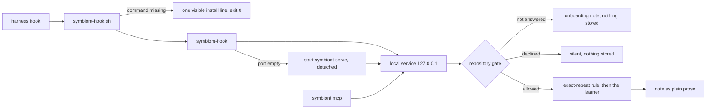

# The symbiont plugin

One bundle, `plugin/symbiont/`, installs symbiont into Claude Code and Muse Code. This page is
the design: what it is made of, the rules it keeps, and the decay each rule prevents.

## What is in the bundle

| Piece | File | Job |
|---|---|---|
| Hooks | `hooks/hooks.json` | session start, prompt submit, tool use, tool failure and stop run `symbiont-hook <event>`; at stop, in an allowed repository once a session has edited code and a later check passed, the model is asked once to reflect and save what was non-obvious through `symbiont_add_lessons` (shown on the dashboard as "from reflection") [measured on Claude Code and Muse Code] |
| Wrapper | `bin/symbiont-hook.sh` | says so, once per session, when the `symbiont` command is missing; always exits 0 |
| MCP server | `.mcp.json` | the one `recall(question)` tool, served by `symbiont mcp` |
| Command | `commands/symbiont.md` | `/symbiont`: status, why a note fired, mute, forget, uninstall help |
| Marketplace | `.claude-plugin/marketplace.json` (repo root) | lets both harnesses install the bundle from GitHub |

The same bundle validates in both harnesses (`claude plugin validate`, `muse plugins validate`).
The two read the same `hooks.json` shape and event names. They differ in one fact the hook needs:
which harness it is running under. Muse Code sets `MUSE_PLUGIN_ROOT` for every plugin hook
and Claude Code does not [measured], so `--harness auto` (the default) reads that variable and one
file serves both.

## Rules and the decay each prevents

- **A missing command or a down service is audible.** The wrapper prints the install command; the
  hook starts a down service once (log in `~/.symbiont/service.log`) and otherwise says
  "symbiont offline" and where the log is. Prevents Silent Fallback: an empty note must never read
  as "nothing to warn about".
- **The hook never blocks the agent.** It exits 0 on every path, including unusable input and an
  unusable reply, each printed as one visible line.
  The harness timeout is set to 2 s in the bundle's `hooks.json` [established].
  A warm call took about 60 ms [measured] on one laptop.
  A call that started the service took about 175 ms [measured] on the same laptop.
  The hook has its own entry point so it imports no learner and no numpy.
  A service that cannot start is not restarted for 30 s [established] (`RETRY_AFTER_S`)
  so a crash loop is not a process spawn per tool call.
- **Nothing is stored without a yes, per repository.** The service keeps three states per
  repository: allowed, declined, never asked. Never asked and declined observe nothing and write no
  event. The first session of a never-asked repository shows one note saying what symbiont does,
  that everything stays on this computer, and the three answers (`symbiont repo allow`,
  `symbiont repo mine`, `symbiont repo decline`). Prevents Silent Fallback at the privacy boundary.
  Known limit: a repository is its directory name, as in the record schema, so two checkouts with
  one name share an answer.
- **Day-one value from one lesson.** `core/repeat.py` is the exact-repeat rule: the same command
  failing with the same normalized error as a stored failure that was later fixed gets "Last time,
  `<command>` failed with <error>; it was fixed when you <edit summary>". It reuses the miner's
  failed-command finder, so a planned failure (the TDD red) is never a repeat, and it says each
  lesson once per session. Prevents Paper Tiger: a plugin that needs weeks of history before it may
  speak fails the first-week user.
- **A pass never gets a note.** A note is about a failed command whose normalized failure signature (the failing test and the message, with numbers, paths and hashes normalized) matches a stored lesson. A command and an exception class alone never match, and a passing or unreported result gets nothing.
- **The developer's words lead.** `symbiont context add <lesson id or last> "<words>"` (or `POST /lessons/<id>/context` with `{text, intentional, priority}`) stores words per lesson. The note then reads "[symbiont] In this repo: <words>. Last time …"; `intentional` silences the lesson.
- **A rule reaches the work it applies to.** A lesson with the developer's words is a rule. It is delivered on a prompt, or on a failed command, when a named file is the lesson's file, in its area (a non-generic directory) or has the same stem without `test_`, or when the text shares at least two salient terms with the rule (its own words and the lesson's file stems, stopwords out). One shared word never fires. At most one rule per prompt or failure, high priority first, once per session for a prompt and again only for a new failure message; `intentional` silences it. The event log says which match fired it (`fired_by`) or why it held back. This prevents a Paper Tiger rule that only fires on the exact failure that taught it, and the opposite noise that teaches the agent to ignore notes.
- **Notes are domain prose.** No scores, thresholds or feature names. `recall` takes one question.
- **Every note can be explained and undone.** Events carry the repository and the kind of trouble,
  never text of the prompt. `symbiont why` reads the last note's cause from the log; `symbiont
  mute` silences a kind of trouble; `symbiont forget` deletes its lessons and keeps them silenced
  if they are mined again. Prevents Black Box in the developer's hands.
- **Nightly training is announced once.** When a repository's first night finishes (its nightly
  record appears), the next session start says so, once. Until then the learner is whatever
  `symbiont serve` was started with (plain counters by default).

## Curation by the session's own model

symbiont makes no model calls. It offers batches, and the model already running the session judges
them through MCP tools: `symbiont_add_lessons` (lessons written from notes or reports the developer
points to, with optional `applies_to` terms and path prefixes), `symbiont_review_candidates` and
`symbiont_save_reviews` (mistake, expected or noise; the plain-words rule becomes the note's lead),
`symbiont_correction_candidates` and `symbiont_save_corrections`, and `symbiont_set_focus` (the
answer to "Anything symbiont should pay attention to?").

- Correction candidates are short user turns after an agent action that use a correcting phrase,
  capped at 200 excerpts, each trimmed. History is shown only to a session of the same harness
  (Claude Code history in Claude Code, Muse Code history in Muse Code); showing one to the other
  needs `symbiont settings set cross_harness true`. Both same-harness switches default on and live in
  `settings.json` in the data directory. The consent note says the session's model will read short
  excerpts of past messages.
- Nothing is stored for a repository that has not said yes.
- The dashboard is served by the local service at `/dashboard?project=NAME`, filled from the store;
  `symbiont dashboard` prints its address. Turns and minutes per occurrence are estimates from the
  length of the recorded fix [hypothesis]; the proof band shows the measured results with their tags.

## Learn from your team's PR reviews

After the focus question, symbiont asks once more: "Want me to learn from this repository's recent
pull-request reviews and CI failures?" On yes, the session's model reads GitHub itself with the
developer's own `gh` access (recent merged pull requests, their review comments, failed check runs)
and saves only durable, repo-specific corrections through `symbiont_add_lessons`: a review comment
that asked for a change plus the commit that made it (kind `correction`), a standing convention
(`rule`), or a CI failure with its cause (`mistake`). It skips bots, nits and style-only remarks,
saves at most 20 lessons from 30 pull requests, and never stores reviewer names or long comment
text. It also saves a short verbatim `quote` of the reviewer's comment that states the rule. `/symbiont learn-from-prs` (or `symbiont learn-from-prs`) prints the same steps any time.

- **Provenance.** Each lesson carries `source_label` ("from PR #412 review", "from CI on PR #415")
  and `source_url` (https only; the route refuses anything else and more than 20 PR lessons per
  call). The dashboard shows the label as a link on the lesson; it can be edited, given context,
  made intentional or dismissed like any other lesson.
- **The reviewer's own words.** A lesson may carry `quote` (at most 300 characters, ending at a
  sentence end; needs a pull request `source_url`) and `quote_role` (`maintainer` or `reviewer`;
  never a name). It is delivered first and whole: `In this repo, a maintainer said on PR #7396:
  "<quote>" (<lesson sentence>).`, in the house-rules note and the file-trigger note alike. The
  quote is model-supplied: the service never sees the review text, so it cannot check it against
  the comment. It refuses a quote with no PR link, a handle or address, a credential, an unknown
  role or one over the cap.
- **Nightly training.** PR-derived lessons are human-confirmed mistakes, so `routeb/review_rows.py`
  turns each into "this lesson was needed here" rows (situation: about to edit the lesson's file;
  answer: the lesson with its label) that `scripts/routeb/nightly.py` appends to the night's
  training file. Remaining: the nightly staleness digest (`service/nightly.lessons_digest`) covers
  mined lessons only and nothing marks these rows trained, so they are retrained on every night
  that has mined lessons to learn, and a repository with only PR lessons does not trigger a night.
- **Privacy.** symbiont makes no network call for this. The harness agent reads GitHub with the
  developer's own access; symbiont stores only the short lessons and the pull-request links, locally
  in `~/.symbiont`. Lesson text from a PR is scrubbed for credentials before it is stored.

## Where it lives

| Concern | Module |
|---|---|
| exact-repeat rule (pure) | `src/symbiont/core/repeat.py` |
| answers, silenced notes, announcements | `src/symbiont/store/repos.py` |
| the gate, in front of the learner | `src/symbiont/service/repo_gate.py` |
| the hook command and service start | `src/symbiont/delivery/hook_main.py`, `launch.py` |
| Muse Code and Claude Code session readers | `src/symbiont/readers/muse_code.py`, `claude_code.py` |
| `/symbiont` commands | `src/symbiont/service/operator_commands.py` |

## Not done yet

- No `PreToolUse` hook: no event before a tool runs carries an outcome, so there is nothing to say
  at that moment, and a hook on every tool call costs time. Failures get their note right after
  they happen.
- Muse Code field names (tool calls, JSON shell results with `exit_code`, `find`/`replace` edits) were checked on one throwaway session [measured]; other Muse tools are read as plain results.
- The judge that checks a note against what it learned (nightly training) is switched on by running
  the nightly job; the plugin does not run it.
